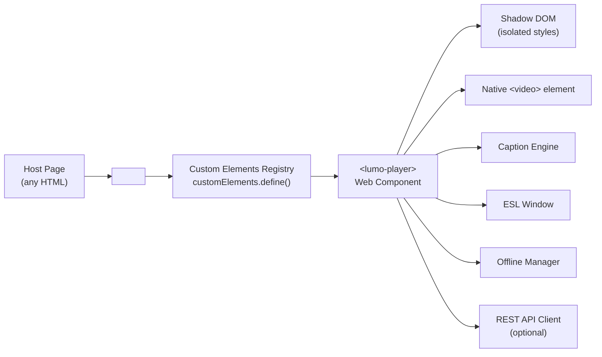
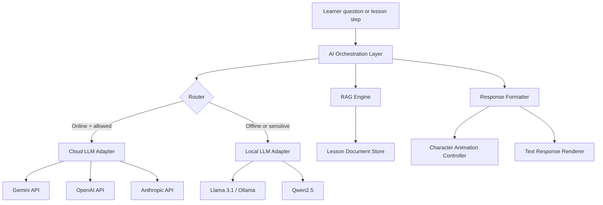
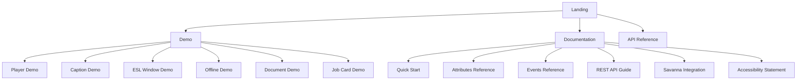
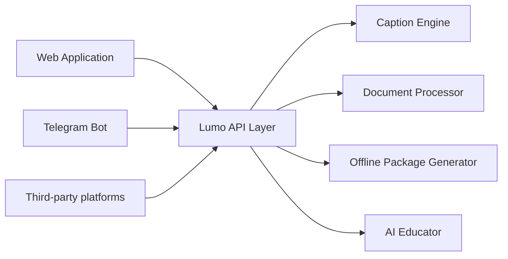
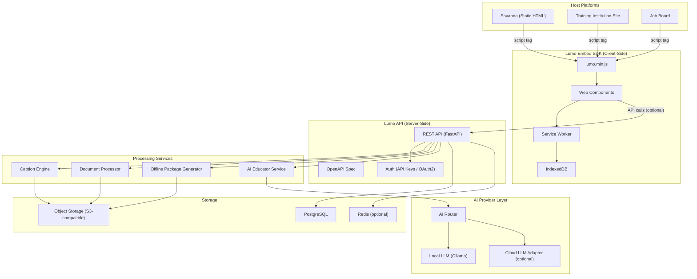
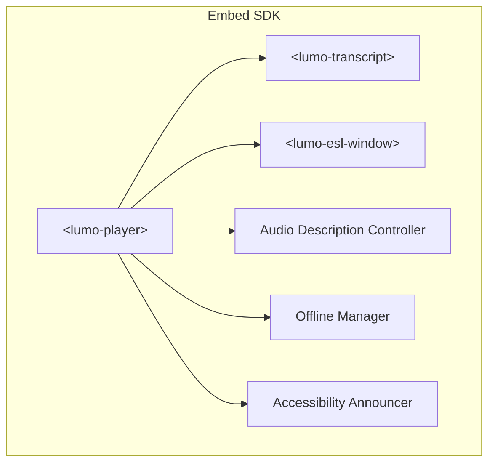
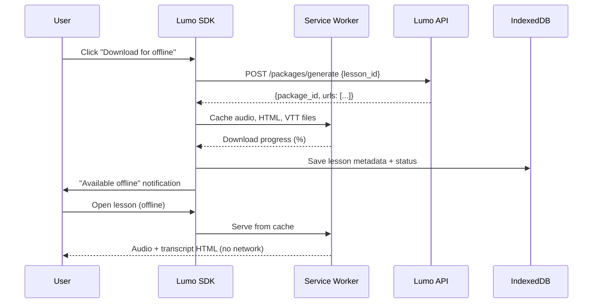
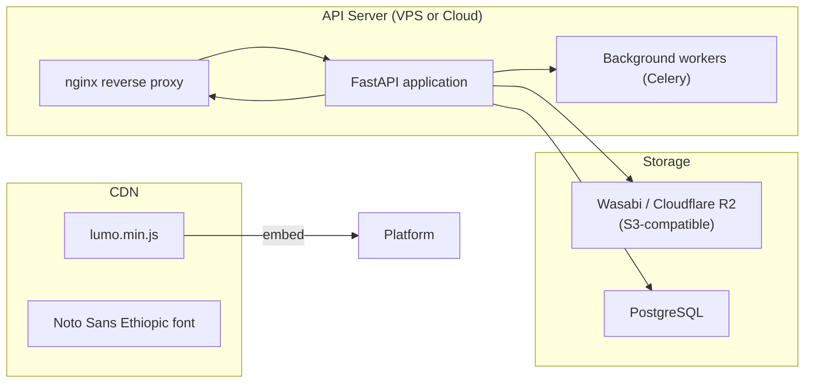
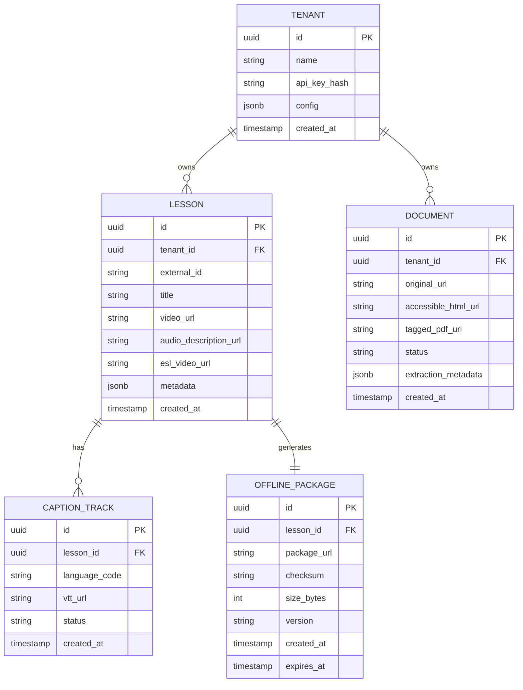

# Blueprint: Lumo — Accessible Learning Media Module
## Digital Bridge Accessibility Hackathon 2026 · Track 2

**Version:** 1.0 · **Date:** 14 November 2026  
**Status:** Planning — Not yet implemented  
**Classification:** Architecture and product reference document

---

## Table of Contents

1. [Executive Summary](#1-executive-summary)
2. [Hackathon Understanding](#2-hackathon-understanding)
3. [Research and Evidence](#3-research-and-evidence)
4. [Problem Analysis](#4-problem-analysis)
5. [User Groups and Personas](#5-user-groups-and-personas)
6. [Human-Centered Design](#6-human-centered-design)
7. [Product Vision and Positioning](#7-product-vision-and-positioning)
8. [Product Modules](#8-product-modules)
9. [Three-Level Integration Architecture](#9-three-level-integration-architecture)
10. [AI Educator Architecture](#10-ai-educator-architecture)
11. [Web Application Design](#11-web-application-design)
12. [Telegram Bot Architecture](#12-telegram-bot-architecture)
13. [System Architecture](#13-system-architecture)
14. [Technology Decisions](#14-technology-decisions)
15. [Data Architecture](#15-data-architecture)
16. [Security and Privacy](#16-security-and-privacy)
17. [Accessibility Architecture](#17-accessibility-architecture)
18. [Ethiopian Localization](#18-ethiopian-localization)
19. [UX/UI and Visual Direction](#19-uxui-and-visual-direction)
20. [Competitive Differentiation](#20-competitive-differentiation)
21. [Sustainability and Operational Model](#21-sustainability-and-operational-model)
22. [Judging Strategy](#22-judging-strategy)
23. [Risks and Mitigations](#23-risks-and-mitigations)
24. [MVP Scope](#24-mvp-scope)
25. [Final Architectural Decisions](#25-final-architectural-decisions)

---

## 1. Executive Summary

### Product Concept

**Lumo** (from the Latin and Amharic-adjacent concept of light/illumination) is a suite of open, embeddable accessibility modules that any learning platform, training institution, or job board can install in one line of HTML. It is not a separate application. It is what turns a platform that cannot serve everyone into one that can.

### The Problem

On 21 October 2026, ALX ran a co-design session with 40+ participants. Most could not finish the core tasks:
- Forms timed out and demanded ID documents refugees do not possess.
- Videos had no captions and no sign language.
- Help systems were English-only.
- Job boards broke under a screen reader.

A participant summarized the brief in one sentence:
> "I do not need a special app. I need the one everyone uses to work with my phone."

Ethiopia has an estimated 15 million people living with disability (17.6% of the population). 95% live in poverty. 27% of university students with disabilities drop out before graduation. 70% of unemployed refugees in Addis Ababa report they want to work. The gap is not motivation. It is access.

### Proposed Solution

Lumo delivers five independent, composable modules:

| Module | What It Removes |
|---|---|
| **Accessible Media Player** | Keyboard/screen-reader exclusion from video learning |
| **Caption and Transcript Engine** | Language barrier for Deaf and hard-of-hearing learners |
| **Ethiopian Sign Language Window** | Exclusion of the Deaf community from visual content |
| **Audio Description Engine** | Exclusion of blind and low-vision learners from visual content |
| **Offline Learning Package** | Internet dependency for learners on 3G or offline |

A sixth module — the **Accessible Document Processor** — converts inaccessible PDFs and HTML into accessible alternatives, satisfying the "Tagged PDF and HTML documents with image descriptions" requirement.

An optional seventh capability — the **AI Educator** — adds source-grounded, multilingual, conversational learning. It is built to be disabled without breaking any of the above.

### Target Users

**Primary:** Deaf learners, blind and low-vision learners, learners with physical disabilities, learners on low-cost Android devices with unstable connectivity, low-literacy learners, refugees and displaced people.

**Secondary:** Platform engineers at ALX, training institutions, and job boards who need to make their systems accessible without rebuilding them.

### Value Proposition

> Any platform. One line. Everyone learns.

Lumo installs in one `<script>` tag. The modules appear inside the host platform's existing pages. The host platform does not need to be rebuilt. The learner does not need a special app.

### Why It Matters

The winning solution will be deployed to Savanna for 3,000 Digital Bridge learners, then to eight job-matching platforms and two regional training institutions. The code is released under an open licence. The team is credited by name. What is built this weekend is meant to be used. By real learners. On real platforms.

---

## 2. Hackathon Understanding

### Track 2 Requirements

**Track:** Accessible Learning Media  
**Primary deliverable:** An embeddable video player and transcript pipeline  
**Primary users:** Deaf, hard-of-hearing, blind, and low-bandwidth learners

**Mandatory requirements (gate criteria):**
1. Player works by keyboard and by screen reader
2. English and Amharic captions — resizable and recolorable
3. Movable, resizable Ethiopian Sign Language window
4. Audio description
5. Offline pack for a 3G phone: audio, text, light HTML
6. Tagged PDF and HTML documents with image descriptions

**Career gateway component (also required):**
- An accessible job card with audio summary at 200% zoom
- Verifiable certificate links to share with employers

**Extra credit:**
- Braille export (`.brf`)
- Viewer for recorded live sessions with captions and chat log

### Gate Criteria (Pass/Fail Before Scoring)

> A module that does not pass the gate is not scored.

1. A co-designer completes the main task unaided — with NVDA, TalkBack, keyboard only, 200% zoom, and sound off
2. `axe-core` returns zero critical and zero serious issues
3. WCAG 2.2 AA conformance report submitted with the code

### Three Integration Levels

| Level | Requirement | Weight Implication |
|---|---|---|
| 1 | Script tag — one line of HTML | Minimum for all teams |
| 2 | REST API with OpenAPI spec | Additional adoption points |
| 3 | Open standard (LTI 1.3, schema.org/JobPosting, Open Badges 3.0) | Maximum adoption points |

**The integration challenge:** A judge must be able to install the module in one hour from documentation alone.

### Savanna Starter Integration

The organizers confirmed:
- Savanna is a **static HTML/CSS/JavaScript site** (language: CSS per GitHub API, confirming static pages)
- Provided as a reference integration target — not a backend requirement
- The module must work inside Savanna and also on other platforms
- Tight coupling to Savanna's specific HTML structure must be avoided

**GitHub API confirmation:** Repository `alx-africa/Savanna-static-pages` exists, created 5 November 2026, is a CSS-primary repository with no framework dependency. This means the embed approach (script tag) is the most appropriate integration path.

### Judging Criteria

| Criterion | Weight | Key Evidence Needed |
|---|---:|---|
| Works for the people it is for | 30 | Co-designer task completion, axe-core clean, WCAG report |
| Can be adopted by another platform | 25 | 1-line install, OpenAPI, one-hour challenge |
| Built for Ethiopia | 15 | Amharic, EthSL, offline, 3G, Android |
| Quality, security, and privacy | 15 | Zero data leaves host without consent, secure architecture |
| Can be kept running | 15 | Low cost, no paid-API lock-in, documented README |

### Explicit Constraints

- No mandatory paid AI API
- No standalone app that only works in a demo
- Must install on somebody else's platform
- No app-only mobile delivery — web is the required primary channel
- Nothing leaves the host without consent
- Submit by 16:30 Sunday: code, README, Docker Compose, WCAG 2.2 AA conformance report

---

## 3. Research and Evidence

### Savanna Starter Analysis

**Verified facts (from GitHub API and training session transcription):**
- Repository: `alx-africa/Savanna-static-pages`
- Created: 5 November 2026
- Primary language: CSS
- Description: null (no description set)
- No framework specified
- 8 forks — indicating teams are actively forking it
- Public, MIT-compatible licence situation unclear (no licence file detected via API)

**Architecture inference (Session 3 transcription, confirmed by API):**
- Savanna is a static site: HTML, CSS, JavaScript
- No React, Next.js, or other SPA framework is assumed
- Integration must work via `<script>` tag injection into existing HTML pages
- The organizer (session VTT) confirmed: "It includes the HTML and the CSS and the JavaScript — something that you guys will benefit to build your solutions on."

**Integration approach selected:** Script embed with Web Component delivery — the safest approach for a static HTML host. No dependency on a specific JavaScript framework.

**Accessibility limitations (inferred, not confirmed by direct audit):**
- Standard static HTML pages do not automatically produce accessible media players
- Native `<video>` controls vary by browser and operating system
- No caption tracks are assumed present without explicit content
- Document accessibility depends on how PDFs are generated

**ASSUMPTION:** The actual Savanna pages served in production may differ from the static starter. The module must degrade gracefully when page structure differs from expected.

### Accessibility Standards Research

**WCAG 2.2 (W3C, October 2023):**

| Criterion | Level | Relevance |
|---|---|---|
| 1.2.2 Captions (Prerecorded) | A | All video must have synchronized captions |
| 1.2.3 Audio Description or Media Alternative | A | Audio description or full text alternative |
| 1.2.5 Audio Description (Prerecorded) | AA | Audio description for all video |
| 2.1.1 Keyboard | A | All controls operable by keyboard |
| 2.4.7 Focus Visible | AA | Visible keyboard focus indicator |
| 4.1.2 Name, Role, Value | A | Custom controls expose ARIA attributes |
| 1.4.2 Audio Control | A | No autoplay with sound |
| 1.4.4 Resize Text | AA | Text scales to 200% without loss |
| 1.4.5 Images of Text | AA | Avoid text as images |
| 2.5.3 Label in Name | A | Accessible name matches visible label |
| 3.3.2 Labels or Instructions | A | Form labels present |

**WAI-ARIA requirements for custom player:**
- `role="toolbar"` for player controls group
- `aria-label` on all icon-only buttons
- `aria-pressed` for toggle controls (captions on/off, audio description)
- `aria-valuenow`, `aria-valuemin`, `aria-valuemax` on seek slider
- `aria-live="polite"` for playback state announcements
- `role="dialog"` for ESL window with accessible title

**WebVTT:**
- Standard caption format for `<track>` elements
- Supports styling via WebVTT region and cue settings
- Amharic text is LTR (Ethiopic script is Left-to-Right — not RTL)
- Font requirement: Noto Sans Ethiopic or Abyssinica SIL for correct rendering
- Line height for Ethiopic: 1.5–1.7 to prevent clipping of ascenders/descenders

**PDF/UA (ISO 14289-1):**
- Requires tagged PDF structure
- Reading order must match visual order
- Images require alt text
- Tables require headers and structure
- Language must be declared

### Ethiopian Sign Language Research

**Verified facts:**
- Ethiopian Sign Language (EthSL) is distinct from ASL, British Sign Language, and all other national sign languages
- Sign language is NOT universal — each country has its own
- EthSL has regional dialects (Addis Ababa, Hawassa, Bahir Dar differ)
- Ethiopian National Association of the Deaf (ENAD) is the primary national organization
- Severe shortage of certified EthSL interpreters
- EthSL finger-spelling uses an Ethiopic (Ge'ez) alphabet system developed in the 1970s
- EthioSign.org is building offline-capable video-based EthSL content

**Technical feasibility assessment:**
- Real-time AI-generated EthSL from arbitrary text: **NOT FEASIBLE** for hackathon
- Pre-recorded interpreter video for content: **FEASIBLE** — this is the correct approach
- The ESL window architecture must assume human interpreter video exists
- Content workflow: interpreter records separately → video uploaded to CMS → synchronized with learning content

**IMPORTANT ARCHITECTURAL DECISION:** The ESL window is a **video overlay system** that plays a pre-recorded interpreter alongside the main video. It is not an AI-generated sign language avatar. AI sign language generation requires validated EthSL motion data that does not exist in sufficient quantity.

### Offline and Low-Bandwidth Research

**Ethiopian mobile context (from training session and research):**
- Most Ethiopians with low-cost Android devices use 3G connections
- Outside cities, internet is often slow, costly, or unavailable
- Low-cost Android phones: often 1–2 GB RAM, Android 8–11, limited storage
- Target: Android 8+ compatibility

**PWA approach (verified):**
- Service Worker with Cache Storage for app shell and static assets
- IndexedDB for structured data (caption text, lesson metadata, progress)
- Background Sync for syncing progress when connectivity returns
- `navigator.storage.persist()` to protect stored content from eviction
- Offline learning package: audio MP3 + text transcript + lightweight HTML (no WebGL, no AI)

**Storage limits (approximate):**
- Chrome on Android: variable, typically 20–80% of available disk
- Request persistent storage to prevent eviction
- Package size target: < 10 MB per lesson unit (audio + transcript + HTML)

### Technology Comparisons

**Media player libraries considered:**

| Library | License | Accessibility | Framework | Decision |
|---|---|---|---|---|
| Plyr | MIT | Good but needs ARIA work | Vanilla JS | Candidate |
| Video.js | Apache 2.0 | Mature ARIA support | Vanilla JS | Strong candidate |
| Native `<video>` + custom controls | — | Full control | No dependency | **Selected for core** |
| Vidstack | MIT | Excellent ARIA | Web Components | Alternative candidate |

**Decision:** Build custom accessible controls over native `<video>` to maintain full ARIA control, avoid library lock-in, and minimize bundle size. Use Vidstack's ARIA patterns as reference but do not import the library as a dependency. This keeps the embed SDK lightweight.

---

## 4. Problem Analysis

### Accessibility Barriers Identified

The 21 October 2026 co-design session documented the following specific barriers:

**Video learning barriers:**
1. No captions on video content
2. No Ethiopian Sign Language interpretation
3. Native browser video controls are not reliably accessible with screen readers
4. Audio-only learners cannot access visual information in videos
5. Learners without internet cannot access any video content

**Document barriers:**
6. PDFs not tagged for screen readers
7. Images without alt text
8. No semantic heading structure
9. Poor reading order in complex layouts

**Platform integration barriers:**
10. Players embedded via iframes break keyboard navigation
11. Focus gets trapped inside iframes
12. Cross-origin restrictions limit communication

**Ethiopian-specific barriers:**
13. No Amharic captions on English-language learning content
14. No EthSL interpretation
15. Content unusable on 3G connections
16. No offline fallback for rural learners
17. Font rendering for Ethiopic script inconsistent across Android browsers

### Ethiopian Context

**Demographics (sources cited in hackathon presentation):**
- 15 million Ethiopians estimated to live with disability (WHO/World Bank 2011)
- 95% of persons with disabilities estimated to live in poverty
- 27% university dropout rate for students with disabilities
- Addis Ababa Association of Persons with Physical Disabilities (AAAPD) is a named partner

**Technology context:**
- Primary device: low-cost Android smartphone
- Connectivity: primarily 3G with frequent outages
- Languages: Amharic (official), Afaan Oromo, Tigrinya, others
- Ethiopic script: Ge'ez (Fidel) — LTR, syllabic, requires specific fonts
- EthSL: distinct national sign language, regional dialects

---

## 5. User Groups and Personas

> These personas are composites for design purposes. They should be verified and refined with real co-designers during the hackathon. No persona should be treated as representing all members of a disability group.

---

### Persona 1: Hana — Deaf learner, Addis Ababa

**Background:** Hana, 23, is a Digital Bridge learner enrolled in a software engineering track. She was born Deaf and communicates primarily in EthSL. She reads Amharic and English but processes information faster through visual language. Her hearing family does not know EthSL.

**Device:** Tecno Spark 10 Pro (Android 12, 4 GB RAM)  
**Connectivity:** Home WiFi (variable), mobile 3G on commute  
**Assistive technology:** No screen reader — she uses her eyes. She uses captions and sign language.

**Primary tasks:**
- Watch a lesson video and understand it completely
- Review what was taught (transcript)
- Ask a question about lesson content

**Barriers she faces today:**
- Video has no captions
- No EthSL interpretation available
- Cannot follow audio-only explanations
- When captions appear in English only, she misses nuance

**What success looks like:**
- She can watch the full lesson with Amharic captions and EthSL interpreter visible
- She can resize the ESL window to see the interpreter clearly while watching
- She can read the full transcript when she wants to review
- She completes all tasks without requesting help from a hearing person

**Design implications:**
- EthSL window must be prominently controllable, not hidden
- Caption font size must be adjustable up to at least 200% of base
- Transcript must be visible without toggling a hidden menu
- Sound-off mode must work — visual everything

---

### Persona 2: Tesfaye — Blind learner, Debre Markos

**Background:** Tesfaye, 31, lost his vision at 19 through illness. He is an experienced NVDA user (Windows) and has also used TalkBack on his phone. He is enrolled in a Digital Bridge course delivered via Savanna.

**Device:** Desktop computer (Windows 10, Chrome), phone (Samsung A03, Android 11)  
**Connectivity:** University lab (WiFi, unreliable), home (no internet)  
**Assistive technology:** NVDA with Chrome on desktop, TalkBack with Chrome on phone

**Primary tasks:**
- Play a video lesson using keyboard only
- Understand what is happening visually in the video
- Download a lesson package for offline use at home
- Read a PDF assignment

**Barriers he faces today:**
- Native Chrome video player controls are inconsistently announced by NVDA
- No audio description — he cannot understand what is on screen
- PDFs are scanned images without text layers
- Download for offline use is not available

**What success looks like:**
- He can play, pause, seek, adjust volume, and toggle captions using keyboard shortcuts only
- Each control announces its current state correctly through NVDA
- Audio description narrates visual content in the video
- He can download an offline package and use it at home without internet
- The PDF is tagged — NVDA reads it in logical order

**Design implications:**
- Every interactive element needs a semantic HTML `<button>` or proper ARIA role
- Focus order must be logical — no keyboard traps
- Seek bar must behave as a range input with arrow key support and time announcements
- Audio description must be a separate selectable audio track (or extended description)
- Offline package must include text transcript as accessible HTML

---

### Persona 3: Rahel — Learner with physical disability, Addis Ababa

**Background:** Rahel, 27, has limited hand mobility due to a nerve condition. She uses keyboard navigation exclusively — she cannot use a mouse or touchscreen reliably for extended sessions. She is a returning learner who previously struggled to use Savanna's video player.

**Device:** Laptop (Windows 11, Chrome)  
**Connectivity:** Home WiFi (stable)  
**Assistive technology:** Keyboard only (no screen reader)

**Primary tasks:**
- Control video playback without a mouse
- Resize and reposition the sign language window using keyboard
- Access transcripts without leaving keyboard focus

**What success looks like:**
- Space bar pauses/plays. Arrow keys seek. Tab moves between controls. Focus ring is visible at all times.
- She can position the ESL window using keyboard commands
- Transcripts are linked and accessible by keyboard

**Design implications:**
- No drag-only interactions — drag must be supplemented by keyboard equivalents
- Focus rings must be highly visible (not suppressed by default styles)
- No time-based interactions that require rapid mouse response

---

### Persona 4: Dawit — Learner with cognitive disability, Addis Ababa

**Background:** Dawit, 20, has dyslexia. He processes written information slowly and benefits from clear visual hierarchy, short sentences, and audio support. He is not a screen-reader user.

**Device:** Android phone, Tecno Pop 7 (3 GB RAM, Android 12)  
**Connectivity:** 3G (variable)  
**Assistive technology:** Browser text-to-speech (via phone accessibility settings)

**Primary tasks:**
- Follow a lesson without being overwhelmed by text
- Understand a caption without excessive reading speed
- Replay a section he missed

**What success looks like:**
- Caption display rate is controllable (playback speed control)
- Large enough text that he can read without straining
- He can seek back 10 seconds with one button
- Simple, predictable interface that does not change unexpectedly

**Design implications:**
- Default caption font size should be legible without zooming
- Playback speed control (0.5×, 0.75×, 1×, 1.25×)
- Avoid flashing or unexpected layout shifts
- Respect `prefers-reduced-motion`

---

### Persona 5: Amira — Refugee learner, Addis Ababa

**Background:** Amira, 25, is a Somali refugee living in Addis Ababa. She has no kebele ID and limited formal education. Her primary language is Somali; she is learning Amharic. She has no disability but faces significant access barriers: identification requirements, language, and unreliable mobile data.

**Device:** Android phone (Samsung A02, 2 GB RAM, Android 10)  
**Connectivity:** Primarily 3G, frequently no signal  
**Assistive technology:** None, but high text load reduces her comprehension

**Primary tasks:**
- Access lesson content when internet is unavailable
- Understand content in a language she is learning

**What success looks like:**
- She can download a lesson package when she has WiFi and play it offline
- The offline package is small enough to fit on her 32 GB device alongside other content
- Simple visual interface with icons she can recognize even if she misreads labels

**Design implications:**
- Offline package must be < 15 MB per lesson
- Interface labels must be supplemented with icons
- No registration required to access offline content
- Download progress must be visible

---

### Persona 6: Meron — Platform engineer, ALX

**Background:** Meron is a full-stack engineer at ALX responsible for Savanna's frontend maintenance. She needs to integrate the accessibility module without breaking existing pages. She has limited time and must be able to verify the integration works without reading extensive documentation.

**Primary tasks:**
- Add the module to Savanna with minimal code changes
- Configure it for a specific video
- Verify it works
- Remove it if something breaks

**What success looks like:**
- Two lines of HTML added to any page produces a working accessible player
- Configuration is simple — a data attribute or JSON object, not a build step
- An integration test script confirms it is working
- Removal is clean — no residual state

**Design implications:**
- SDK must be a single self-contained JavaScript file
- No build step or npm install required for basic integration
- Explicit rollback procedure documented
- CSP-compatible by default

---

## 6. Human-Centered Design

### Co-Design Principles (from Session 1, Hussein Ali)

The session was led by Hussein Ali — disability and inclusion specialist at Ubongo International, regional expansion lead for East Africa, and a person with lived experience of visual impairment. His instructions were:

**What co-design means:**
- People with disabilities share decisions from day one — not at the approval stage
- Co-designers are experts in their own experience
- UNCRPD Article 4 requires close consulting and actively involving persons with disabilities in decisions that affect them
- "Nothing about us without us" is not a slogan — it is a standard

**The co-design loop for the hackathon:**
1. Ask — observe how they currently register, learn, or find work
2. Work through the problem — sketch, prototype
3. Check it in — does it address what they said?
4. Test it — give them the prototype on their own phone or screen reader
5. Fix or change it — based on what actually happened, not what was expected
6. Test again
7. Pitch — only after the loop runs at least twice

**Six questions to ask co-designers:**
1. Show me how you usually do this task
2. What is the hardest part?
3. What do you do when you get stuck?
4. While testing: tell me what you are thinking as you go
5. Is this simple or complex? What did you expect to happen here?
6. If you could change one thing, what would it be?

**What not to do:**
- Do not ask them to approve a finished product
- Do not guess what users need — ask
- Do not test only with the team
- Do not promise what cannot be delivered

### Consent and Safety

> From Session 1 — these requirements apply to the hackathon.

- Ask permission before using someone's name, photo, voice, or story in the pitch
- Collect only data needed for the product (not test data you will not use)
- Respect participant time — pay or meaningfully recognize co-designers
- Allow participants to skip questions or stop at any point
- Some refugees and displaced people have lived through trauma — do not ask unnecessary personal history
- Share materials in formats participants can actually access
- Do not promise capabilities the team cannot deliver

### Research Approach

| Phase | Activity | Participants | Method |
|---|---|---|---|
| Before hackathon | Review transcriptions, existing research | — | Document analysis |
| Hackathon Day 1 AM | Meet co-designer, observe current task flow | Assigned co-designer | Observation |
| Hackathon Day 1 AM | Ask six questions | Assigned co-designer | Structured interview |
| Hackathon Day 1 PM | First prototype test | Co-designer on own device | Think-aloud |
| Hackathon Day 1 PM | Record issues and feedback | — | Note-taking |
| Hackathon Day 2 AM | Apply changes | — | Development |
| Hackathon Day 2 PM | Second test | Co-designer on own device | Think-aloud |
| Hackathon Day 2 PM | Measure task completion | Co-designer | Task scoring |
| Submission | WCAG conformance report, test results | — | Documentation |

### Acceptance Criteria for Real-User Testing

The gate criteria define minimum acceptance. The testing protocol adds:

**Pass criteria for each task:**
- Task completed without help from team member or interpreter
- No navigation errors that required starting over
- No dead ends where participant could not proceed
- No critical ARIA announcement failures

**Severity classification:**
- **P0 — Blocker:** Task cannot be completed at all
- **P1 — Critical:** Task completed with major difficulty or error
- **P2 — Significant:** Task completed but with noticeable friction
- **P3 — Minor:** Task completed easily but improvement suggested

---

## 7. Product Vision and Positioning

### Product Identity

**Name:** Lumo  
**Tagline:** Any platform. One line. Everyone learns.  
**Mission:** Remove every barrier between a learner with a disability and the course they are enrolled in, without requiring the platform to rebuild itself.

### Value Proposition

**For learners:** You use the platform you were enrolled in. It just works for your screen reader, your sign language, your offline connection, and your phone.

**For platform engineers:** Two lines of HTML. No build step. No new backend. No disruption to existing pages.

**For organisations (ALX, training institutions):** One open-source module handles all five mandatory accessibility requirements. It satisfies WCAG 2.2 AA without a full accessibility audit and rebuild. It costs nothing to install and nothing to run for the core features.

### Differentiation

| What exists today | What Lumo provides |
|---|---|
| Generic accessibility toolbars (increase font, contrast toggle) | Purpose-built media accessibility — captions, ESL, audio description |
| Screen-reader-hostile custom video players | WCAG 2.2 AA-compliant accessible player built for keyboard and screen reader |
| English-only subtitles | English + Amharic captions with Ethiopic font and line-height |
| Generic sign language (usually ASL avatars) | Architecture for real, human-recorded Ethiopian Sign Language |
| Online-only learning | Offline package for 3G and no-connectivity environments |
| AI tools requiring paid API keys | AI-provider-independent architecture — open source first |
| Integration requiring full platform rebuild | One `<script>` tag, no build step |

### Product Boundaries

**Lumo does:**
- Provide an accessible media player via Web Component
- Provide caption rendering for English and Amharic
- Provide an ESL interpreter window (video overlay, human content required)
- Provide audio description switching
- Provide offline package generation and delivery
- Provide accessible document conversion (PDF → accessible HTML)
- Expose REST APIs for all capabilities
- Support LTI 1.3 integration path

**Lumo does not:**
- Generate EthSL signs from arbitrary text — real interpreter content required
- Replace the host platform's LMS
- Require a paid AI API for core features
- Require a React, Vue, or Angular environment
- Require a build step for basic integration

### Non-Goals

- Full LMS replacement
- Real-time AI sign language generation
- Video hosting (uses existing platform media)
- User management (uses host platform authentication)
- Curriculum creation
- Native mobile applications

---

## 8. Product Modules

### Module 1: Accessible Media Player

**Problem solved:** Native browser `<video>` controls are inconsistently accessible across screen readers and do not support caption resizing, ESL overlay, or audio description switching.

**Users:** All learner groups, particularly blind/low-vision (screen reader), Deaf (captions, ESL window), physical disability (keyboard-only), low-bandwidth (adaptive quality).

**Capabilities:**
- Play/Pause with spacebar and button
- Seek with arrow keys (5-second increments, keyboard)
- Volume control with keyboard
- Caption toggle
- Audio description toggle
- ESL window toggle
- Playback speed (0.5×, 0.75×, 1×, 1.25×, 1.5×)
- Fullscreen
- 10-second back/forward skip buttons
- Current time and duration announced on change
- Error state handling with accessible error message

**Inputs:** Video URL (or `<source>` attributes), caption track URLs (`.vtt`), audio description track URL (or separate video URL), ESL video URL

**Outputs:** Rendered accessible player in host page

**Keyboard interaction specification:**

| Key | Action |
|---|---|
| Space | Play/Pause |
| Left arrow | Seek back 5 seconds |
| Right arrow | Seek forward 5 seconds |
| Up arrow | Volume up 10% |
| Down arrow | Volume down 10% |
| M | Toggle mute |
| C | Toggle captions |
| D | Toggle audio description |
| S | Toggle ESL window |
| F | Toggle fullscreen |
| Tab | Move focus to next control |
| Shift+Tab | Move focus to previous control |

**ARIA requirements:**
- Player container: `role="region"`, `aria-label="Video player"`
- Toolbar: `role="toolbar"`, `aria-label="Playback controls"`
- Play/Pause: `<button aria-label="Play" aria-pressed="false">` (updates dynamically)
- Seek: `<input type="range" aria-label="Seek" aria-valuetext="1 minute 30 seconds">`
- Volume: `<input type="range" aria-label="Volume" aria-valuenow="80" aria-valuemin="0" aria-valuemax="100">`
- Caption toggle: `<button aria-label="Captions" aria-pressed="false">`
- Status announcer: `<div aria-live="polite" aria-atomic="true">` for state changes

**Dependencies:** None (pure vanilla JS + HTML + CSS)

**Integration method:** Web Component — `<lumo-player>` custom element

**Acceptance criteria:**
- Passes axe-core with zero critical/serious issues
- All controls reachable by Tab
- Play/Pause works with Space key
- Seek bar responds to arrow keys and announces position
- State changes announced by screen reader (NVDA + Chrome, TalkBack + Chrome)
- Works at 200% zoom without horizontal scrolling or control overlap
- No autoplay with sound on page load

**MVP scope:** All above capabilities except fullscreen (defer to post-hackathon)

---

### Module 2: Caption and Transcript Engine

**Problem solved:** Learners who are Deaf, hard-of-hearing, low-literacy, or learning a second language cannot follow audio-only or English-only content.

**Users:** Deaf users (primary), hard-of-hearing users, language learners, low-literacy users who benefit from text reinforcement.

**Capabilities:**
- WebVTT caption track loading and display
- English caption track support
- Amharic (Ethiopic script) caption track support
- Caption font size: adjustable from 100% to 200% of base in steps
- Caption color: selectable foreground/background combinations (at minimum: white-on-black, yellow-on-black, black-on-white)
- Caption positioning: bottom (default), top (optional override)
- Caption font: Noto Sans Ethiopic for Amharic, system sans-serif for English
- Caption background opacity: adjustable
- Transcript view: full text of all captions displayed in scrollable panel, synchronized with playback
- Language switching (English ↔ Amharic) during playback
- Accessible caption settings panel

**Inputs:** WebVTT file URL(s) with language codes (`en`, `am`)

**WebVTT format required:**
```
WEBVTT

00:00:05.000 --> 00:00:10.000 lang:am
ሰላም ወደ ክፍለ ጊዜ አንድ

00:00:10.000 --> 00:00:15.000 lang:en
Welcome to lesson one
```

**Ethiopic script requirements:**
- Font: Noto Sans Ethiopic (loaded from Google Fonts CDN or bundled)
- Direction: LTR (Ethiopic is NOT RTL)
- Line height: 1.6 minimum to prevent clipping
- Letter spacing: 0 (do not apply tracking to Ethiopic)
- HTML lang attribute: `lang="am"` on caption container
- Unicode block: U+1200–U+137F (core Ethiopic), U+AB01–U+AB2F (extended)
- UTF-8 encoding mandatory in all VTT files

**Transcript accessibility:**
- Transcript is a scrollable `<div>` with `role="log"` or plain semantic HTML `<p>` elements
- Current caption highlighted in transcript during playback
- Transcript searchable via browser's native Ctrl+F
- Transcript downloadable as plain text file

**Dependencies:** Module 1 (player)

**Integration method:** Included in `<lumo-player>` component; can also be used standalone as `<lumo-transcript>`

**Acceptance criteria:**
- Amharic captions render correctly with Noto Sans Ethiopic font on Android Chrome
- Caption text does not overflow or clip at any specified size
- Language switch does not cause flash of unstyled content
- Transcript is keyboard-reachable and readable by screen reader

**MVP scope:** English and Amharic captions, transcript view, font size and color adjustment. Caption positioning: post-hackathon.

---

### Module 3: Ethiopian Sign Language Window

**Problem solved:** Deaf learners who communicate in EthSL cannot access video content that has no sign language interpretation.

**Users:** Deaf learners (primary users of EthSL). Note: not all Deaf learners use EthSL — some are more comfortable with written language. The window is optional and user-controlled.

**Capabilities:**
- Overlay window displaying a pre-recorded EthSL interpreter video
- Synchronized with main video playback (play, pause, seek)
- Movable: drag to any position in the viewport, keyboard repositioning
- Resizable: resize handles + keyboard resizing
- Minimum size: 180 × 240px (preserves interpreter visibility)
- Maximum size: 50% of viewport width
- Position memory: saved to localStorage for the user's session
- Toggle visibility with keyboard shortcut (S)
- Close button accessible by keyboard
- Interpreter video does not play audio by default (muted, unless user enables it)

**Inputs:** ESL interpreter video URL (must be provided by content author — no AI generation)

**Content workflow (for content authors):**
1. Record lesson video (original content)
2. Commission a certified EthSL interpreter to record interpretation
3. Upload both videos to platform media storage
4. Provide both URLs to the `<lumo-player>` component

**Keyboard repositioning:**
- When ESL window has focus: arrow keys move the window 20px per press
- Shift + arrow keys resize the window
- Escape resets position to default corner
- Position announced to screen reader after each move

**Screen reader interaction:**
- ESL window container: `role="dialog"` with `aria-label="Ethiopian Sign Language interpreter"`
- When window opens: focus moves to close button within dialog
- When window closes: focus returns to ESL toggle button

**Dependencies:** Module 1 (player), Module 2 (caption synchronization)

**CRITICAL ASSUMPTION:** Interpreter video content must be provided externally. The module provides the architecture and UI; it does not generate sign language. If no ESL video URL is provided, the ESL button is hidden.

**Acceptance criteria:**
- Window moves by keyboard and by mouse drag
- Window resizes by keyboard and by mouse drag
- Window is announced correctly by screen reader when opened
- Focus management is correct (focus enters dialog when opened, returns to button when closed)
- Underlying video controls remain accessible when window is visible
- Works at 200% zoom without window becoming inaccessible

**MVP scope:** All above capabilities. Regional EthSL dialect support: post-hackathon.

---

### Module 4: Audio Description Engine

**Problem solved:** Blind and low-vision learners cannot understand visual information in videos that is not conveyed by audio.

**Users:** Blind learners (primary), low-vision learners, learners who benefit from enriched audio narration.

**Capabilities:**
- Two implementation strategies (see decision below)
- Audio description toggle button in player
- Accessible label "Audio description" with current state announced
- Fallback: text-based extended description when audio track is unavailable

**Implementation strategy decision:**

| Approach | Pros | Cons |
|---|---|---|
| Separate described video version | Simplest for content authors; most compatible | Requires double video storage; seeking must stay synchronized |
| Secondary audio-only track | Single video file; cleaner sync | Requires platform support for multiple audio tracks (MediaSource API) |
| WebVTT text descriptions (read by screen reader) | No additional media file | Screen reader must read while audio plays — can conflict |

**Selected approach:** Separate described video version as primary. Text-based description (via WebVTT `descriptions` track) as fallback.

**Content workflow:**
1. Create original video
2. Commission audio description recording (narrator describes visual content in natural pauses)
3. Upload described version to platform
4. Provide described video URL to `<lumo-player>`

**When no audio description video is provided:**
- If a `descriptions` WebVTT track is provided: announce via `aria-live` region
- If neither is provided: audio description button is hidden; note in conformance report

**Acceptance criteria:**
- Switching to audio description does not reset playback position
- Audio description button state is announced (on/off)
- Text description fallback is announced by screen reader without interrupting caption display

**MVP scope:** Separate video version approach. Text track fallback: post-hackathon.

---

### Module 5: Offline Learning Package

**Problem solved:** Learners with no internet connection or unreliable 3G cannot access any lesson content.

**Users:** All learner groups in low-connectivity environments. Specifically: Tesfaye at home without internet; Amira with intermittent 3G; rural learners.

**Capabilities:**
- Download button available in player
- Downloads a lesson package (zip or individual files)
- Package contents:
  - `lesson.html` — lightweight accessible HTML with embedded transcript
  - `audio.mp3` — audio track extracted from video (or separate audio file)
  - `captions-en.vtt` — English captions
  - `captions-am.vtt` — Amharic captions
  - `transcript-en.txt` — plain text transcript (English)
  - `transcript-am.txt` — plain text transcript (Amharic)
  - `manifest.json` — lesson metadata and version
- Service Worker caches the package after first download
- Offline HTML player uses `<audio>` element (not `<video>`) with caption display
- No WebGL, no AI, no external network calls in offline mode
- Package version tracking — user is notified when an update is available

**Package size targets:**
- Audio: 64 kbps MP3 for speech content — approximately 4 MB per hour
- HTML: < 50 KB
- VTT files: < 500 KB for a 2-hour lesson
- Total target: < 10 MB per lesson unit

**Service Worker scope:**
- Cache static assets on first load (app shell)
- Cache lesson packages on demand (after user clicks download)
- Serve from cache when offline
- Background sync when connectivity returns

**IndexedDB usage:**
- Stored: lesson metadata, download status, playback position, user preferences
- NOT stored: learner identity, grades, or any personally identifiable information

**Security:**
- Lesson packages signed with content hash in manifest
- Offline HTML uses `Content-Security-Policy` header to prevent external requests
- No tracking scripts in offline HTML

**Acceptance criteria:**
- Download completes on 3G connection (may be slow — progress bar shown)
- Offline HTML plays audio and displays captions without internet
- Transcript is readable by screen reader in offline mode
- Package integrity verified before use
- Works on Android 8+ in Chrome for Android

**MVP scope:** Audio + transcript + HTML offline. Video offline: post-hackathon (storage size).

---

### Module 6: Accessible Document Processor

**Problem solved:** PDFs and other documents provided in learning courses are frequently inaccessible — scanned images, untagged structure, no alt text.

**Users:** Blind and low-vision learners (primary); low-literacy learners who benefit from clean HTML.

**Capabilities:**
- API endpoint accepts PDF upload
- Extracts text using PDF text extraction (not OCR for text PDFs)
- Applies heading detection heuristics
- Generates accessible HTML output with:
  - Semantic headings (`<h1>`–`<h6>`)
  - Paragraph structure
  - Table markup with headers
  - Image extraction with alt-text placeholder (requires human review)
- Generates Tagged PDF using PDF/UA rules (output)
- Returns both accessible HTML and tagged PDF

**What it does NOT do:**
- OCR on scanned images (requires separate OCR pipeline — marked as future)
- Auto-generate meaningful image alt text (requires human input or AI with human review)
- Handle DRM-protected PDFs

**Inputs:** PDF file (uploaded via API or referenced by URL)  
**Outputs:** Accessible HTML, tagged PDF, extraction metadata (confidence scores)

**Human review workflow:** The API returns flagged sections requiring human review (images without alt text, complex tables). These must be reviewed before the document is published as accessible.

**Integration method:** REST API endpoint. No Web Component required (output is a document, not an inline player).

**Acceptance criteria:**
- Extracted HTML is readable by NVDA in logical order
- Heading structure matches visual document hierarchy in at least 80% of test documents
- API responds within 10 seconds for a typical course document (< 10 MB)
- Output HTML passes axe-core with zero critical issues

**MVP scope:** Text PDF → accessible HTML. Tagged PDF output: post-hackathon.

---

### Module 7: AI Educator (Optional Capability)

**Problem solved:** Learners cannot ask follow-up questions or get explanations in their own language from course content. English-only explanations exclude Amharic-speaking learners.

**Users:** All learner groups who want conversational support beyond watching videos.

**Position in product:** Optional. Disabled by default. The player, captions, ESL, audio description, and offline package all work without it.

**Capabilities (target state, not MVP):**
- Document ingestion: PDF, video transcript, presentation
- Source-grounded Q&A: answers cite the course content
- Amharic and English support
- 3D educator character (optional — disabled on low-end devices)
- Conversation history within a session
- Interactive concept visualization (mathematics, diagrams)

**MVP scope:** Text-only Q&A, English only, source-grounded from lesson transcript. Amharic: second release. 3D character: third release.

**Provider-independent architecture:** Abstraction layer accepts any LLM via standardized interface. Default: open-source model (Llama 3.1 or Qwen2.5). Commercial API: optional adapter.

---

## 9. Three-Level Integration Architecture

### Level 1 — JavaScript Embed (Script Tag)

**Target audience:** Platform engineers who can add HTML to their pages.

**How it works:**

```html
<!-- Step 1: Load the module (once per page, in <head> or before </body>) -->
<script src="https://cdn.lumo-a11y.dev/v1/lumo.min.js" defer></script>

<!-- Step 2: Place the player where you want it -->
<lumo-player
  src="https://your-platform.com/videos/lesson-01.mp4"
  captions-en="https://your-platform.com/captions/lesson-01-en.vtt"
  captions-am="https://your-platform.com/captions/lesson-01-am.vtt"
  esl-src="https://your-platform.com/videos/lesson-01-esl.mp4"
  audio-description-src="https://your-platform.com/videos/lesson-01-ad.mp4"
  offline-enabled="true"
></lumo-player>
```

That is the complete integration for a basic deployment.

**Technical architecture:**



**Shadow DOM isolation:**
- Player styles are scoped to Shadow DOM — host page CSS cannot break them
- Host page CSS cannot accidentally override caption colors or focus rings
- Light DOM elements (the `<lumo-player>` tag itself) can be styled by host

**CSP requirements:**
- `script-src`: must include the CDN origin
- `media-src`: must include the video host origin
- `font-src`: must include Google Fonts CDN (for Noto Sans Ethiopic) or fonts can be bundled
- Lumo SDK does not require `unsafe-inline` or `unsafe-eval`

**SDK bundle targets:**
- Core player: < 40 KB gzipped
- Caption engine: included in core
- ESL window: lazy-loaded on demand
- Offline manager: lazy-loaded on demand
- Full bundle (all modules): < 100 KB gzipped

**Versioning:**
- Semver — `v1.2.3`
- CDN URL includes major version: `/v1/lumo.min.js`
- Breaking changes require major version bump
- Old versions remain available for minimum 2 years

**Events emitted:**
- `lumo:play` — video playback started
- `lumo:pause` — video paused
- `lumo:captionchange` — caption language or state changed
- `lumo:eslopen` / `lumo:eslclose` — ESL window toggled
- `lumo:offline:download` — offline package download started
- `lumo:offline:ready` — offline package available
- `lumo:error` — playback or loading error

**Configuration alternatives:**
```html
<!-- Via JSON config attribute -->
<lumo-player config='{"src":"...","offline":true}'></lumo-player>

<!-- Via JavaScript initialization -->
<script>
  Lumo.init('#my-video-container', {
    src: 'https://...',
    captionsEn: 'https://...',
    captionsAm: 'https://...'
  });
</script>
```

---

### Level 2 — REST API

**Target audience:** Platform developers who want to build custom UI while using Lumo's accessibility services.

**Base URL:** `https://api.lumo-a11y.dev/v1`

**Authentication:** API key in `X-Lumo-Key` header (or OAuth 2.0 for multi-tenant deployments)

**Proposed endpoints:**

| Method | Path | Description |
|---|---|---|
| `POST` | `/captions/generate` | Submit video URL for automatic caption generation (AI, requires review) |
| `GET` | `/captions/{id}` | Retrieve generated caption file in WebVTT format |
| `POST` | `/documents/process` | Submit PDF for accessibility remediation |
| `GET` | `/documents/{id}` | Retrieve accessible HTML or tagged PDF |
| `POST` | `/packages/generate` | Generate offline learning package |
| `GET` | `/packages/{id}/download` | Download offline package (zip) |
| `POST` | `/lessons/{id}/ask` | Submit a question about lesson content (AI educator) |
| `GET` | `/health` | Service health check |

**OpenAPI specification:** Generated and published at `https://api.lumo-a11y.dev/v1/openapi.json`

**Error response format:**
```json
{
  "error": {
    "code": "CAPTION_NOT_FOUND",
    "message": "No caption track found for the specified ID",
    "details": null
  },
  "request_id": "req_01jd..."
}
```

**Rate limits:**
- Unauthenticated: 10 requests per minute per IP
- API key: 100 requests per minute per key
- Document processing: 20 submissions per hour per key

**Tenant isolation:**
- Each API key is scoped to a tenant
- Tenant data is never shared between organizations
- Tenant-specific configuration (default fonts, caption colors) stored per key

---

### Level 3 — Open Standards

**LTI 1.3 (Learning Tools Interoperability):**

**Applies to:** Universities and training institutions using Moodle, Canvas, Blackboard, D2L Brightspace, or other LTI-compatible LMS platforms.

**How it works:**
1. Institution administrator registers Lumo as an LTI 1.3 tool in their LMS
2. Instructor adds a Lumo-enhanced video as an LTI activity in a course
3. Student clicks the activity — LMS sends signed JWT to Lumo
4. Lumo validates JWT using LMS public JWKS URL
5. Lumo renders the accessible player inside the LMS
6. Optionally: LTI Advantage Grades API sends completion status back to LMS gradebook

**Implementation priority:** Level 3 is a post-hackathon enhancement. At hackathon time, produce:
- LTI 1.3 integration guide (documented capability)
- LTI registration metadata endpoint (`/lti/config`)
- Basic LTI launch handler (validates JWT, renders player)

**Technical limitation:** LTI tools are typically served in iframes. Modern browser third-party cookie restrictions require `SameSite=None; Secure` on session cookies.

**schema.org/JobPosting:**

**Applies to:** The career gateway component required by all tracks.

```json
{
  "@context": "https://schema.org",
  "@type": "JobPosting",
  "title": "Software Engineer",
  "accessibilitySummary": "This employer provides accessible interview accommodations on request.",
  "employmentType": "FULL_TIME",
  "accessibilityFeature": ["audioDescription", "captionsEnabled"]
}
```

**Where used:** Accessible job cards produced by the Track 2 career gateway component. These expose structured data that assistive technology and AI search engines can read.

**Open Badges 3.0:**

**Applies to:** Verifiable certificate links to share with employers (Track 2 requirement).

**How it works:**
- Learner completes a course
- Platform issues an Open Badge 3.0 credential (JSON-LD, signed)
- Badge is verifiable at a URL that employers can click
- Badge includes accessibility feature completed (e.g., "completed with EthSL")

**Implementation priority:** Badge generation is a post-hackathon feature. At hackathon time, produce a verifiable certificate link using a UUID-based URL with a JSON metadata page.

---

### Savanna Integration

**What Savanna is (verified):** A static HTML/CSS/JavaScript site — no server-side framework. Pages contain existing HTML structure for displaying lesson content.

**Integration procedure for Savanna:**

```html
<!-- Add to <head> in Savanna's HTML template -->
<link rel="preconnect" href="https://fonts.googleapis.com">
<link href="https://fonts.googleapis.com/css2?family=Noto+Sans+Ethiopic:wght@400;600&display=swap" rel="stylesheet">
<script src="https://cdn.lumo-a11y.dev/v1/lumo.min.js" defer></script>
```

```html
<!-- Replace existing <video> tags with <lumo-player> -->
<!-- Before: -->
<video src="lesson-01.mp4" controls></video>

<!-- After: -->
<lumo-player
  src="lesson-01.mp4"
  captions-en="lesson-01-en.vtt"
  captions-am="lesson-01-am.vtt"
></lumo-player>
```

**What does not change:** All existing Savanna HTML structure, navigation, enrollment workflows, and backend APIs remain untouched.

**Rollback procedure:** Remove the two `<head>` lines and replace `<lumo-player>` tags with the original `<video>` tags.

---

### One-Hour Integration Challenge

**Challenge design:** A judge should be able to integrate Lumo into a standard HTML page in one hour.

**Success path:**
1. Read `README.md` Quick Start section (5 minutes)
2. Add script tag to HTML page (2 minutes)
3. Add `<lumo-player>` element (3 minutes)
4. Provide caption file URLs (10 minutes — time to find or create a `.vtt` file)
5. Test that captions appear (5 minutes)
6. Test keyboard navigation (10 minutes)
7. Run axe-core extension (5 minutes)
8. Confirm zero critical issues (verify)

Total: ~40 minutes, leaving 20 minutes of buffer for questions.

**Documentation required (produced before hackathon):**
- Quick Start guide (5-step, < 500 words)
- Configuration reference (all attributes)
- VTT file examples (English and Amharic)
- Troubleshooting: CSP errors, font loading, offline issues

---

## 10. AI Educator Architecture

> This section documents the intended architecture for the optional AI Educator capability. It is not part of the MVP. No AI educator will be implemented before the core accessibility modules are complete.

### Character Design

**Character:** Custom full-body 3D character  
**Format:** VRM (Virtual Reality Model) or GLB (GLTF Binary)  
**Rendering:** Three.js with React Three Fiber wrapper  
**Animations:** AnimationMixer with predefined state machine

**Animation states:**
- Idle (subtle breathing, eye movement)
- Speaking (lip sync via viseme sequence)
- Pointing (gesture toward highlighted element)
- Thinking (brief pause animation)
- Listening (nod, attention posture)

**Viseme-based lip synchronization:**
- TTS output includes phoneme/viseme sequence
- AnimationMixer blends between viseme shapes in real time
- 15 standard viseme targets (compatible with VRM specification)

### Teaching Environment

**Hybrid environment:** Character appears in a panel alongside interactive learning content. The character does not replace the content — it narrates and annotates it.

**Example — chain rule explanation:**
1. Concept identified: chain rule (from lesson transcript)
2. Character explains the mathematical idea in natural language
3. `<lumo-math>` component renders an interactive derivative visualization
4. Character's gesture overlays highlight inner/outer function regions
5. Learner can interrupt with a question at any point
6. Character responds, citing the lesson source

**Components:**
- `<lumo-educator>` — 3D character panel (optional, can be hidden)
- `<lumo-explain>` — explanation text without character
- `<lumo-math>` — interactive math visualization (KaTeX + simple SVG)
- `<lumo-diagram>` — interactive diagram renderer

### AI Architecture (Provider-Independent)



**Provider abstraction interface:**
```typescript
interface LLMProvider {
  complete(prompt: string, options: CompletionOptions): Promise<string>;
  stream(prompt: string, options: CompletionOptions): AsyncIterable<string>;
  supportsLanguage(language: string): boolean;
  isAvailable(): Promise<boolean>;
}
```

**Default provider:** A self-hosted Llama 3.1 8B Q4 instance via Ollama. This requires no paid API key and can run on a \$20/month VPS for a small deployment.

**Commercial adapters:** Gemini, OpenAI, Anthropic — optional, plug-in via environment variable.

### Language Strategy

**English:** Full support. Llama 3.1 and all commercial models handle English well.

**Amharic:** Degraded support. Current LLMs produce less accurate Amharic than English. Mitigation strategies:
1. Use multilingual models tested against Amharic (Qwen2.5 has better multilingual support than Llama for low-resource languages)
2. RAG: answers grounded in lesson text reduce hallucination even if generation quality is lower
3. NLLB translation bridge: generate in English, translate to Amharic using NLLB-200 (open-source, runs locally)
4. Native Amharic speaker review before releasing AI responses in production

**Afaan Oromo:** Not in MVP. Marked as quality-gated expansion requiring native speaker testing.

**Voice:**
- TTS: Coqui TTS (open-source, Amharic support experimental) or ElevenLabs (commercial, optional)
- STT: Whisper (OpenAI, runs locally, good Amharic support)

### Optionality

The AI Educator is disabled by default. To enable:
```html
<lumo-player
  ai-educator="true"
  lesson-id="lesson-01"
>
```

If `ai-educator` is not set or is `false`:
- No AI requests are made
- No network connection to AI services
- No data leaves the host page
- All core accessibility features work normally

**Progressive enhancement path:**
1. Text explanation only (no character, no TTS)
2. Text + character (3D model, no TTS)
3. Text + character + TTS (full experience)

Level 1 works on any device. Level 3 requires WebGL and reasonable processing power.

---

## 11. Web Application Design

### Purpose

The web application is the reference implementation and testing environment. It is not a competing product — it demonstrates that the modules work together and validates them with real users.

### Routes

| Route | Purpose |
|---|---|
| `/` | Landing page — explains what Lumo is, links to docs |
| `/demo` | Demonstration page — all modules shown in context |
| `/demo/player` | Player module in isolation |
| `/demo/captions` | Caption module demonstration |
| `/demo/esl` | ESL window demonstration |
| `/demo/offline` | Offline package download demonstration |
| `/demo/documents` | Document accessibility demonstration |
| `/jobs` | Accessible job card demonstration (career gateway) |
| `/docs` | Integration documentation |
| `/api/docs` | Interactive OpenAPI documentation |

### Information Architecture



### Key Demonstration Flows

**Flow 1 — Deaf learner arrives:**
1. Demonstration video plays with captions off
2. User enables Amharic captions — Ethiopic text appears with correct font
3. User opens ESL window — interpreter video appears in corner
4. User drags ESL window to preferred position
5. Transcript is opened — synchronized with playback

**Flow 2 — Blind learner arrives:**
1. User navigates to player using Tab only
2. Play/Pause works via Space key
3. Audio description is enabled — narrator describes visual content
4. Offline download is initiated via keyboard

**Flow 3 — Platform engineer arrives:**
1. Quick Start guide visible on landing page
2. Code example shows two lines of HTML
3. Live sandbox shows module appearing in real time

### Responsive Design

**Breakpoints:**
- Mobile: 320px–767px (single column, ESL window docked to bottom)
- Tablet: 768px–1023px (player full width, ESL window overlapping)
- Desktop: 1024px+ (player wide, ESL window floating)

**ESL window on mobile:**
- Cannot be positioned freely on small screens
- Docked to bottom-right, with option to maximize to half screen
- Keyboard repositioning not meaningful at mobile scale — replaced by toggle between compact and expanded states

---

## 12. Telegram Bot Architecture

> This is a future phase. No Telegram bot implementation begins before the web application and core modules are validated.

### Role

The Telegram bot is a second delivery channel for the same accessibility services. It reuses all backend APIs — no business logic is duplicated.

### Shared Services



### Telegram Interaction Model

**Primary use case:** A learner without web access can interact with lesson content via Telegram.

**Commands:**
- `/lesson [lesson_id]` — get lesson audio and transcript
- `/caption [language]` — receive caption file for most recent lesson
- `/ask [question]` — ask AI educator about lesson content
- `/offline` — receive offline package download link

**Accessible conversation design:**
- All messages include text — no image-only responses
- Language auto-detected from user's Telegram language setting
- RTL text in Arabic supported via Telegram's native RTL rendering
- Each message is screen-reader readable via Telegram's native accessibility

### Security in Telegram Context

- No sensitive learner data stored in Telegram chat history
- Session identification via Telegram user ID — not email or government ID
- All transcript requests limited to enrolled courses (verified via API key tied to learner session)

### Limitations

- Telegram does not support custom Web Components — accessibility features are delivered differently (audio files, text transcripts)
- Video playback in Telegram is not fully accessible — link out to web player for full experience
- No sign language window in Telegram — ESL content accessible only via web player

---

## 13. System Architecture

### High-Level Architecture



### Component Architecture



### Data Flow Diagrams

**Caption flow:**

```mermaid
sequenceDiagram
    participant P as Platform Page
    participant SDK as Lumo SDK
    participant V as Video Element
    participant CE as Caption Engine

    P->>SDK: Load lumo.js
    SDK->>P: Register &lt;lumo-player&gt; element
    P->>SDK: &lt;lumo-player captions-en="..." captions-am="..."&gt;
    SDK->>CE: Fetch .vtt files
    CE-->>SDK: WebVTT content
    SDK->>V: &lt;track kind="captions" srclang="en"&gt;
    SDK->>V: &lt;track kind="captions" srclang="am"&gt;
    V-->>SDK: Caption cue events
    SDK->>P: Render styled caption overlay
```

**Offline download flow:**



### Deployment Architecture



**Hosting strategy:**
- SDK/CDN: Cloudflare CDN (low cost, global edge)
- API: Single VPS (Hetzner CX21 or similar) — scales to small cloud when needed
- Storage: Wasabi or Cloudflare R2 (no egress fees — critical for cost control)
- Database: PostgreSQL on same VPS for MVP

**Estimated monthly cost (MVP):**
- VPS: \$5–10/month (Hetzner)
- Storage: \$6/month (Wasabi, 1 TB)
- CDN: \$0 (Cloudflare free tier)
- Domain: \$12/year
- Total: ~\$20–25/month for MVP infrastructure

---

## 14. Technology Decisions

### Frontend

| Decision | Options Considered | Selected | Reasoning |
|---|---|---|---|
| Embed delivery | iFrame, Web Component, React component | **Web Component (Custom Elements + Shadow DOM)** | Framework-independent; works in Savanna's static HTML; no React required; Shadow DOM protects styles |
| Player controls | Plyr, Video.js, Vidstack, custom | **Custom over native `<video>`** | Full ARIA control; minimal bundle; no library lock-in; Vidstack patterns referenced but not imported |
| Animation | Framer Motion, GSAP, CSS transitions | **CSS transitions + Framer Motion for reference implementation** | Framer Motion selected for web app only; SDK uses CSS to avoid adding React dependency to embed |
| Caption rendering | WebVTT via `<track>`, custom overlay | **WebVTT with custom styled overlay** | Native `<track>` styling is limited; custom overlay enables Ethiopic font and resizing |
| Font loading | Bundle, CDN, system | **Google Fonts CDN with font-display:swap** | Noto Sans Ethiopic is not on most Android devices; CDN load with swap prevents render blocking |

### Backend

| Decision | Options Considered | Selected | Reasoning |
|---|---|---|---|
| API framework | FastAPI, Django REST, Express | **FastAPI (Python)** | Automatic OpenAPI generation; async support; Pydantic validation; Python ecosystem for AI/ML |
| Background processing | Celery + Redis, FastAPI BackgroundTasks, RQ | **Celery + Redis (MVP: FastAPI BackgroundTasks)** | Document processing is async; MVP uses built-in background tasks to avoid Redis dependency |
| Authentication | JWT, API keys, OAuth2 | **API keys for embed SDK, OAuth2 for multi-tenant** | Simple API keys sufficient for hackathon; OAuth2 for production |

### Storage

| Decision | Options Considered | Selected | Reasoning |
|---|---|---|---|
| Object storage | AWS S3, Cloudflare R2, Wasabi | **Wasabi (dev) / Cloudflare R2 (production)** | No egress fees; S3-compatible API; significantly lower cost than AWS S3 |
| Database | PostgreSQL, SQLite, MongoDB | **PostgreSQL** | Relational data; tenant isolation via schema; SQLite for development |
| Client storage | LocalStorage, IndexedDB, Cache API | **IndexedDB + Cache API** | Cache API for file caching; IndexedDB for structured metadata |

### AI and Language

| Decision | Options Considered | Selected | Reasoning |
|---|---|---|---|
| Default LLM | Llama 3.1, Mistral, Gemma, Qwen2.5 | **Llama 3.1 8B Q4 via Ollama** | No API key; runs on \$20/month VPS; acceptable quality for grounded Q&A |
| Multilingual | Llama 3.1, Qwen2.5, Aya | **Qwen2.5-7B for Amharic** (better multilingual) | Qwen2.5 scores higher on Ethiopian language tasks than Llama 3.1 |
| STT | Whisper, Deepgram, AssemblyAI | **OpenAI Whisper (local)** | Open-source; runs locally; good Amharic support |
| TTS | Coqui TTS, ElevenLabs, Google | **Coqui TTS (local) with ElevenLabs as optional premium** | No API cost for Coqui; Amharic support experimental — requires testing |
| Translation | NLLB-200, Argos Translate, Google | **NLLB-200 (local)** | 200 languages; runs locally; better than Argos for Amharic |

### Accessibility Tools

| Decision | Options Considered | Selected | Reasoning |
|---|---|---|---|
| Automated testing | axe-core, Pa11y, Lighthouse | **axe-core** (required by hackathon gate) | Required; most comprehensive; integrates with Jest and Playwright |
| Screen reader testing | NVDA/Chrome, JAWS/Chrome, TalkBack | **NVDA + Chrome (desktop), TalkBack + Chrome (mobile)** | Most common screen reader on Windows; TalkBack required for Android |
| Focus management library | Focus-trap, custom | **Custom (minimal)** | Libraries often over-complicate; focus-trap used for ESL dialog only |

---

## 15. Data Architecture

### Core Entities



### Client-Side Storage (IndexedDB)

**Store: `lessons`**
```json
{
  "id": "lesson-01",
  "title": "Introduction to Python",
  "offlineStatus": "available",
  "downloadedAt": "2026-11-14T10:00:00Z",
  "version": "1.2.0",
  "audioUrl": "blob://...",
  "transcriptEn": "...",
  "transcriptAm": "..."
}
```

**Store: `preferences`**
```json
{
  "captionSize": 1.2,
  "captionColor": "white-on-black",
  "captionLanguage": "am",
  "eslWindowPosition": {"x": 20, "y": 20},
  "eslWindowSize": {"w": 300, "h": 400}
}
```

**What is NOT stored client-side:**
- Learner name, email, or identity
- Grades or assessment results
- Payment information
- Health or disability status

### Tenant Isolation

- Each tenant has a unique UUID and API key
- Tenant data stored in PostgreSQL with `tenant_id` column on all tables
- Row-Level Security enforced at database level
- API validates `tenant_id` matches API key on every request
- Tenant configuration (caption defaults, ESL video defaults) stored separately

### Retention Policies

| Data | Retention |
|---|---|
| Generated caption files | 90 days after last access, then archived |
| Processed documents | 30 days after last access |
| Offline packages | 30 days after generation |
| API access logs | 90 days (without request body) |
| Error logs | 30 days |
| Client-side IndexedDB | Until user clears browser storage |

---

## 16. Security and Privacy

### Threat Model

| Threat | Vector | Mitigation |
|---|---|---|
| Malicious script injection | Host page injects code into Lumo | Shadow DOM isolation; no `eval()`; strict CSP in SDK |
| Data exfiltration | SDK sends learner data to third party | No learner data collected; data-minimization by design |
| API key theft | Key exposed in browser | API keys used for server-to-server calls only; embed SDK uses public tenant ID |
| Cross-tenant data access | Tenant A queries Tenant B data | Row-level security; API key scoped to tenant |
| Malicious PDF upload | Uploaded PDF contains embedded scripts | PDF processed in sandboxed environment; no script execution |
| CORS bypass | Third party calls API pretending to be allowed host | CORS allowlist per tenant; API key required |
| ESL window frame injection | ESL video URL replaced with malicious content | URL validation; allowlist of approved media origins per tenant |
| Offline package tampering | Downloaded package replaced with malicious content | SHA-256 checksum in `manifest.json`; verified before use |

### Privacy Model

**What Lumo collects:**
- API request logs (timestamp, endpoint, tenant ID, response status) — no request body
- Error reports (stack trace, component name, tenant ID) — no user identity

**What Lumo does NOT collect:**
- Learner name, email, or identity
- Disability status or accommodation preferences
- Video watch history
- Scroll position or reading behavior
- Device fingerprint
- IP address in persistent logs (hashed for rate limiting only)

**Data flows:**
- Caption and transcript data: flows from platform media storage → user browser → no copy sent to Lumo servers
- Offline packages: generated once, downloaded directly by user, no copy retained by Lumo beyond retention period
- AI educator queries: sent to AI provider only if the feature is explicitly enabled by both tenant and user

**Consent model:**
- Offline download: explicit user action (clicking download button) = consent
- AI educator: explicitly enabled by tenant (opt-in); user can disable
- Preferences (caption size, colors): stored locally only; never sent to server

**"Nothing leaves the host without consent" (hackathon requirement):**
- Core player, captions, ESL window, audio description: no network request to Lumo servers
- Document processing: upload is explicit user action to submit document for processing
- AI educator: opt-in; user controls whether queries are sent

### Security Controls

| Control | Implementation |
|---|---|
| Input validation | Pydantic models on all API inputs; file type validation |
| Output encoding | Jinja2 auto-escaping for HTML output; JSON responses properly encoded |
| Transport security | TLS 1.3 required; HSTS header |
| Authentication | API keys: bcrypt hashed in database; sent via header only |
| Rate limiting | nginx rate limiting + application-level per-tenant limits |
| CSRF protection | Not required (API is stateless); cookie-less design |
| Dependency scanning | GitHub Dependabot; npm audit in CI |
| File upload | Size limits; type validation; sandboxed processing |

---

## 17. Accessibility Architecture

### WCAG 2.2 AA Compliance Map

| WCAG Criterion | Player | Captions | ESL Window | Offline | Documents |
|---|---|---|---|---|---|
| 1.2.2 Captions (Prerecorded) | ✓ | ✓ | — | ✓ | — |
| 1.2.3 Audio Description or Alternative | ✓ | — | — | ✓ (transcript) | — |
| 1.2.5 Audio Description (Prerecorded) | ✓ | — | — | — | — |
| 2.1.1 Keyboard | ✓ | ✓ | ✓ | ✓ | ✓ |
| 2.4.3 Focus Order | ✓ | ✓ | ✓ | ✓ | ✓ |
| 2.4.7 Focus Visible | ✓ | ✓ | ✓ | ✓ | ✓ |
| 4.1.2 Name, Role, Value | ✓ | ✓ | ✓ | ✓ | ✓ |
| 1.4.4 Resize Text | ✓ | ✓ | ✓ | ✓ | ✓ |
| 1.3.1 Info and Relationships | ✓ | ✓ | ✓ | ✓ | ✓ |

### Keyboard Behavior Summary

All interactive elements must be reachable by Tab. All controls must be operable by keyboard alone. See Module 1 for complete keyboard shortcut table.

**Focus ring:** `outline: 3px solid #0066cc; outline-offset: 2px;` — overrides browser default where insufficient.

**Focus trapping:** Only within the ESL window dialog when it is open.

### Screen Reader Behavior

**Tested configurations (target):**
- NVDA 2024 + Chrome (desktop)
- TalkBack + Chrome on Android 11+
- VoiceOver + Safari on iOS (stretch target)

**Key screen reader behaviors:**
- Play button announces "Play video" initially; "Pause video" when playing
- Seek bar announces position as "2 minutes 30 seconds" (not "150")
- Caption toggle announces "Captions: English" or "Captions: off"
- ESL window announces "Ethiopian Sign Language interpreter open"
- Errors announce "Video failed to load: check your connection"
- Download progress announces "Download 45% complete" at 25% intervals

### Reduced Motion

All animations respect `prefers-reduced-motion: reduce`:
- ESL window drag: instant position change instead of animated movement
- Caption appear: instant instead of fade-in
- Controls appear: instant instead of slide-up

```css
@media (prefers-reduced-motion: reduce) {
  .lumo-transition { transition: none !important; }
  .lumo-animate { animation: none !important; }
}
```

### Low-Bandwidth Fallback

The core player works with no AI features and no server calls. If the CDN is unavailable:
- Self-hosted fallback: organisations can host `lumo.min.js` themselves
- Native `<video>` fallback: if Lumo SDK fails to load, native `<video>` renders

---

## 18. Ethiopian Localization

### Amharic and Ethiopic Script

**Character set:** Unicode Ethiopic block (U+1200–U+137F, Ge'ez/Fidel script)

**Direction:** LEFT-TO-RIGHT — Ethiopic is not RTL. Never apply `dir="rtl"` to Amharic.

**Font:** Noto Sans Ethiopic (Google Fonts, open source, comprehensive Unicode coverage)

**CSS requirements:**
```css
:lang(am) {
  font-family: 'Noto Sans Ethiopic', system-ui, sans-serif;
  line-height: 1.65;
  letter-spacing: 0;
  word-break: normal;
}
```

**HTML lang declaration:**
```html
<div lang="am" dir="ltr">ሰላም ወደ ክፍለ ጊዜ አንድ</div>
```

**Caption file for Amharic:**
```
WEBVTT

1
00:00:05.000 --> 00:00:10.000
<lang am>ሰላም ወደ ክፍለ ጊዜ አንድ</lang>
```

### Ethiopian Sign Language

**What Lumo provides:**
- An architecture for displaying pre-recorded EthSL interpreter video
- Synchronized playback, movable/resizable window
- Contact with ENAD (Ethiopian National Association of the Deaf) for content partnerships recommended

**What Lumo does not provide:**
- AI-generated EthSL (not feasible at hackathon quality level)
- Coverage of regional EthSL dialects (architecture supports multiple ESL tracks per lesson — post-hackathon)

**Content production workflow:**
1. Identify certified EthSL interpreter (via ENAD)
2. Interpreter watches source video
3. Interpreter records interpretation in a studio-quality setup
4. Video is synchronized with source content
5. Uploaded to platform
6. ESL video URL provided to `<lumo-player esl-src="...">`

### Low-Cost Android Support

**Target devices:** Android 8+ (API level 26+), 1–4 GB RAM, 32–64 GB storage

**Performance budgets:**
- SDK load: < 100ms on 3G (40 KB gzipped)
- Player init: < 200ms after script load
- Caption render: < 16ms per frame (no layout thrashing)
- Offline package download time: acceptable on 3G (progress shown)

**Compatibility:**
- Chrome for Android 70+ (covers Android 8+)
- No WebGL required for player or captions
- WebGL required only for 3D AI educator (graceful degradation if unavailable)
- Shadow DOM supported in all target browsers

**Android-specific concerns:**
- TalkBack accessibility tested explicitly
- Touch targets: minimum 48×48 dp
- Font rendering: Noto Sans Ethiopic renders correctly in Chrome for Android
- Video: H.264/AAC baseline profile for maximum compatibility
- Offline: `navigator.storage.persist()` requested to prevent storage eviction

### Afaan Oromo Roadmap

**Position:** Quality-gated future expansion. Not in MVP or hackathon demonstration.

**Requirements before launch:**
1. Obtain corpus of Afaan Oromo educational text
2. Test TTS quality with native speakers
3. Test STT accuracy (Whisper) with native speakers
4. Commission Afaan Oromo caption translation for pilot lessons
5. Recruit Afaan Oromo-speaking co-designers for user testing

**Do not claim Afaan Oromo support until these tests are complete.**

---

## 19. UX/UI and Visual Direction

*Informed by the installed ui-ux-pro-max, emil-design-eng, framer-motion, taste-skill, and scroll-craft skills.*

### Design Philosophy

Lumo's visual design follows a single governing principle: **the content is the product, not the interface**. The accessibility controls must be unambiguous and easy to find, but they must not compete with the learning content they serve.

This is not an opportunity for visual flair. This is an opportunity for interface clarity.

> "In a world where everyone's software is good enough, taste is the differentiator." — Emil Kowalski

For an accessibility tool, taste means: every pixel has a function. No decoration that creates confusion. No color that reduces contrast. No animation that causes harm.

### Interface Principles

1. **Visible always:** Caption button, ESL button, offline button are never hidden behind a "settings" menu on the first interaction
2. **Predictable:** Controls appear in the same position every time, on every lesson
3. **Clear hierarchy:** Player controls > caption text > ESL window > transcript > everything else
4. **Fail gracefully:** If a feature is unavailable (no ESL video, no audio description), the button is hidden — not shown as disabled (which creates confusion for screen reader users about why it is there)
5. **Respect reduced motion:** No decorative animation in the accessibility widget itself

### Visual System

**Color palette (WCAG AA contrast compliant):**
| Token | Value | Contrast against white | Use |
|---|---|---|---|
| `--lumo-primary` | `#1a3c6e` | 9.1:1 ✓ | Primary buttons, focus rings |
| `--lumo-on-primary` | `#ffffff` | — | Text on primary |
| `--lumo-surface` | `#1a1a2e` | — | Player dark background |
| `--lumo-on-surface` | `#f0f0f0` | 14.3:1 ✓ | Player control icons |
| `--lumo-caption-bg` | `rgba(0,0,0,0.85)` | — | Caption background |
| `--lumo-caption-text` | `#ffffff` | 15.0:1 ✓ | Default caption text |
| `--lumo-focus-ring` | `#0066cc` | 7.5:1 ✓ | Focus outline |

**Typography:**
- Controls: system-ui, -apple-system, sans-serif (no custom font for controls — reliability on Android)
- Captions (English): system-ui, sans-serif
- Captions (Amharic): Noto Sans Ethiopic, system-ui
- Minimum font size: 14px for controls, 16px default for captions, 24px for captions at 150%

**Component specifications (following Emil Kowalski philosophy):**
- Buttons: `border-radius: 6px` — not too rounded (looks unprofessional at scale), not squared
- Focus ring: `outline: 3px solid var(--lumo-focus-ring); outline-offset: 2px` — always visible, never `outline: none`
- Transitions: `150ms ease-out` for state changes — instant feels broken, 300ms feels sluggish for a control
- Touch targets: 48×48px minimum on mobile — slightly larger than WCAG 44px recommendation for comfort

**Motion (from Framer Motion skill):**
- ESL window drag: smooth with spring physics — `stiffness: 300, damping: 30`
- ESL window open: scale from 0.95 to 1.0, 150ms — signals where it came from
- Caption fade: `opacity 100ms` only — reduced-motion fallback is instant
- All motion: disabled when `prefers-reduced-motion: reduce`

**Icons:**
- Iconography: Heroicons (MIT license, accessible SVG)
- All icons: `aria-hidden="true"` with adjacent visible text or `aria-label` on button
- No icon-only buttons without accessible labels

### Responsive Behavior

**Player on mobile (< 768px):**
- Controls stack in two rows — primary controls (play, seek) top row; secondary (captions, ESL, download) bottom row
- Caption text: 18px minimum — readable without zooming
- ESL window: docked bottom-right, tap to expand

**Player on desktop (> 1024px):**
- Full control bar visible at all times (no hover-to-reveal)
- Caption customization panel: slide-out side panel
- ESL window: floating, freely movable

**At 200% zoom:**
- All controls visible and usable
- Caption text scales proportionally
- No horizontal scrolling introduced
- ESL window remains accessible (may dock to avoid overflow)

---

## 20. Competitive Differentiation

### What Exists Today

| Solution | Limitation |
|---|---|
| UserWay / accessiBe | Overlay toolbars — do not fix semantic HTML; often make things worse for screen readers; no media-specific accessibility |
| YouTube accessibility | Caption-only; no EthSL; no Ethiopic rendering; no offline; external platform |
| Kaltura accessible player | Enterprise cost; no Amharic; no EthSL; no offline for 3G |
| Generic WebVTT players | No Ethiopic font; no offline; no ESL; no ARIA management |
| AI avatar solutions (D-ID, HeyGen) | No EthSL; no WCAG compliance focus; expensive API; no offline |

### Lumo's Differentiation

1. **Ethiopia-specific:** Amharic Ethiopic rendering, EthSL architecture, 3G offline — no other solution addresses this combination
2. **Standard-compliant:** WCAG 2.2 AA, WAI-ARIA, WebVTT — not an overlay hack
3. **One-line install:** True script-tag embed that works on any static page
4. **Provider-independent AI:** No paid API key required for core features
5. **Open source:** Released under MIT licence — platform adoption is free
6. **Co-designed:** Built with people with disabilities from the first day

### Why Organizations Would Adopt Lumo

| Motivation | Evidence |
|---|---|
| Legal compliance | WCAG 2.2 AA required for inclusive platforms; conformance report included |
| User reach | 15 million Ethiopians with disability; Deaf community excluded without EthSL |
| Technical simplicity | One script tag; no rebuild; no framework dependency |
| Cost | Free to install; infrastructure costs ~\$20/month; no per-use API fees for core |
| Credibility | WCAG conformance report; real-user testing with axe-core clean |

---

## 21. Sustainability and Operational Model

### Open-Source Strategy

Lumo is released under the MIT license. This means:
- Any organization can install it for free
- Any organization can fork and modify it
- Contributions from ALX engineers, training institutions, and community members can improve it
- The winning team is credited by name in the codebase and documentation

### Operating Costs

**MVP infrastructure:**

| Component | Service | Monthly Cost |
|---|---|---|
| API server | Hetzner CX21 (2 vCPU, 4 GB RAM) | \$5.80 |
| Object storage | Wasabi Standard (1 TB) | \$5.99 |
| CDN | Cloudflare free tier | \$0 |
| Domain | (amortized) | \$1 |
| **Total** | | **~\$13/month** |

**AI educator (optional, local):**

| Component | Service | Monthly Cost |
|---|---|---|
| AI server | Hetzner AX41 (Ryzen 5, 64 GB) | \$30 |
| Llama 3.1 8B model | Self-hosted via Ollama | \$0 |
| **Additional** | | **~\$30/month** |

**Scaling to 3,000 learners:**
- API server: scale to Hetzner CX31 (\$10/month) or add one replica
- Storage: Wasabi costs are linear with usage
- CDN: Cloudflare free tier handles millions of requests
- Total estimated for 3,000 learners: \$30–50/month

**No paid AI API is required for core features.** The AI educator is optional and can run entirely on self-hosted open-source models.

### Provider Independence

| Capability | Default (free) | Optional commercial |
|---|---|---|
| LLM | Llama 3.1 / Ollama | Gemini, OpenAI, Anthropic |
| TTS | Coqui TTS | ElevenLabs, Google Cloud TTS |
| STT | Whisper (local) | Deepgram, AssemblyAI |
| Translation | NLLB-200 | DeepL, Google Translate |
| Storage | Wasabi | AWS S3, Cloudflare R2 |
| CDN | Cloudflare | Fastly, Akamai |

### Maintainability

- Modular architecture: each module can be updated independently
- Semantic versioning: breaking changes clearly communicated
- OpenAPI specification: API changes tracked and versioned
- Comprehensive README and documentation
- Docker Compose for self-hosted deployment
- GitHub Actions CI/CD pipeline

---

## 22. Judging Strategy

### Works for the People (30 points)

| Evidence | How Demonstrated |
|---|---|
| Co-designer completes tasks unaided | Live demo during hackathon + video recording |
| axe-core zero critical/serious | Run in CI; show output at demo |
| WCAG 2.2 AA conformance report | Submitted with code |
| Real device testing | Demo on actual low-cost Android device |
| Screen reader testing | NVDA + Chrome demonstrated live |
| Amharic captions rendered correctly | Demonstrate with Noto Sans Ethiopic visible |

### Platform Adoption (25 points)

| Evidence | How Demonstrated |
|---|---|
| One-line install | Show before/after: original Savanna HTML → Lumo-enhanced |
| One-hour challenge | Judge given only README; timed installation |
| OpenAPI documentation | Live Swagger UI at `/api/docs` |
| Savanna integration guide | In documentation |
| LTI 1.3 integration path | Documented capability + `/lti/config` endpoint |

### Ethiopia (15 points)

| Evidence | How Demonstrated |
|---|---|
| Amharic Ethiopic captions | Live demo, correct font rendering |
| EthSL window | Demo with sample interpreter video |
| Offline on 3G Android | Demo download and offline playback |
| Low-cost Android tested | Specific device documented in test report |

### Quality, Security, Privacy (15 points)

| Evidence | How Demonstrated |
|---|---|
| Zero data leaves host without consent | Architecture diagram showing data flows |
| Privacy policy (data minimization) | Documented in `/docs/privacy` |
| Secure API | Authentication on all endpoints; rate limiting |
| CSP-compatible embed | Content-Security-Policy header documentation |

### Sustainability (15 points)

| Evidence | How Demonstrated |
|---|---|
| Total monthly cost: ~\$13 | Cost breakdown in README |
| No paid API lock-in | Architecture diagram; default open-source providers |
| Docker Compose deployment | Submit with code |
| README a stranger can follow | One-hour integration challenge |
| Open-source licence | MIT licence in repository |

---

## 23. Risks and Mitigations

| Risk | Probability | Impact | Mitigation | Contingency |
|---|---|---|---|---|
| EthSL interpreter video not available for demo | High | High | Prepare sample interpreter recording; partner with ENAD early | Demo architecture with placeholder video — clearly labeled |
| Amharic TTS quality insufficient | Medium | Medium | Test multiple providers before committing; use text-only fallback | Caption-only Amharic mode; remove TTS from demo |
| axe-core fails on ESL dialog focus management | Medium | Critical | Follow WAI-ARIA dialog pattern exactly; test early and often | Simplify dialog to panel; ensure keyboard escape works |
| Offline Service Worker not registering on Android | Medium | High | Test on actual Android device early; multiple test devices | Show offline capability via download link (simpler approach) |
| Co-designer cannot complete task on first prototype | High | High | Build simplest possible first version; don't over-engineer early UI | Rapid iteration based on feedback; prioritize NVDA over visual polish |
| Noto Sans Ethiopic not loading on demo device | Low | Medium | Preload font; bundle font as fallback; test on demo device | Show screenshot of correct rendering if live fails |
| GitHub API rate limits during development | Low | Low | Use authenticated API calls; cache responses | Manual inspection of repository files |
| Co-designer not available on Day 1 morning | Low | High | Confirm in advance; have written test tasks ready | Use team member familiar with NVDA to run first tests |
| VTT caption synchronization off in Amharic | Medium | Medium | Test with actual Amharic content; validate timing | Adjust cue times manually; note as known issue |
| AI educator feature destabilizes core accessibility | Low | High | AI educator is strictly optional; feature flag; never released with core | Remove AI educator from demo; core modules unaffected |

---

## 24. MVP Scope

### P0 — Required for Hackathon Gate

These must work and be demonstrated to pass scoring:

- [ ] Accessible media player: keyboard control, ARIA, screen reader compatible
- [ ] English captions: WebVTT, synchronized, displayed correctly
- [ ] Amharic captions: Ethiopic font, correct line height, synchronized
- [ ] Caption resize: at least 100%, 150%, 200%
- [ ] Caption color: at least white-on-black, yellow-on-black
- [ ] ESL window: appears, is movable (mouse drag), closable
- [ ] ESL window: keyboard accessible (Tab focus, Escape to close)
- [ ] Audio description: separate video version switchable
- [ ] Offline package download: audio + transcript + HTML
- [ ] Offline HTML: plays audio and shows captions without internet
- [ ] Accessible HTML document output: semantic headings, screen-reader readable
- [ ] Script tag embed: works in Savanna static HTML
- [ ] axe-core: zero critical, zero serious issues
- [ ] WCAG 2.2 AA conformance report: submitted
- [ ] Co-designer task completion: documented

### P1 — Important for Reliable Product

- [ ] WebVTT generation API endpoint
- [ ] Document processing API endpoint (PDF → HTML)
- [ ] OpenAPI specification published
- [ ] Quick Start documentation (5 steps)
- [ ] One-hour integration challenge walkthrough documented
- [ ] Accessible job card (career gateway)

### P2 — Valuable Extensions

- [ ] Caption positioning (top/bottom)
- [ ] ESL window keyboard repositioning (arrow keys)
- [ ] Offline package versioning and update notification
- [ ] LTI 1.3 integration guide + config endpoint
- [ ] AI educator: text-only, English, source-grounded Q&A

### P3 — Post-Hackathon Roadmap

- [ ] AI 3D educator character
- [ ] Amharic AI educator
- [ ] Afaan Oromo (quality-gated)
- [ ] Braille export (.brf)
- [ ] Live session viewer with captions and chat log
- [ ] Open Badges 3.0
- [ ] OCR for scanned PDFs
- [ ] EthSL regional dialect support

---

## 25. Final Architectural Decisions

### Confirmed Decisions

| # | Decision | Rationale |
|---|---|---|
| A1 | Web Component embed (not iFrame) | Framework-independent; Shadow DOM isolation; works in Savanna static HTML |
| A2 | Custom accessible player controls over native `<video>` | Full ARIA control; consistent cross-browser; caption styling |
| A3 | ESL window is pre-recorded video overlay, not AI-generated | No validated EthSL motion data exists; AI generation not feasible at quality level required |
| A4 | Audio description: separate described video version | Most compatible; safest synchronization approach |
| A5 | Offline package: audio + text + HTML only (no video offline in MVP) | Storage size; MP3 audio is 20× smaller than video |
| A6 | FastAPI backend | Automatic OpenAPI generation; async; Pydantic; Python AI ecosystem |
| A7 | No paid AI API required for core features | Hackathon sustainability requirement; open-source first |
| A8 | Llama 3.1 / Qwen2.5 via Ollama as default AI | No API key; runs on \$30/month VPS; acceptable quality |
| A9 | Amharic is LTR — no RTL CSS applied | Ethiopic script is Left-to-Right; RTL would break rendering |
| A10 | Noto Sans Ethiopic via Google Fonts CDN | Not available in Android system fonts; CDN load with font-display:swap |
| A11 | Telegram bot is Phase 2, after web validation | Sequential delivery; shared APIs; Telegram has different accessibility model |
| A12 | Privacy: core modules make zero server calls | "Nothing leaves the host without consent" — enforced by architecture, not policy |

### Unresolved Questions and Assumptions

| # | Question / Assumption | Status | Action Required |
|---|---|---|---|
| U1 | **ASSUMPTION:** Savanna static pages use standard HTML `<video>` tags that can be replaced with `<lumo-player>` | Unverified | Inspect actual Savanna page HTML during hackathon Day 1 |
| U2 | **QUESTION:** Is a certified EthSL interpreter available to record sample content for the demo? | Unresolved | Contact ENAD or check if AAAPD can facilitate |
| U3 | **ASSUMPTION:** Chrome for Android on Android 8 supports Shadow DOM v1 | Likely true (Chrome 61+) | Verify on target device during development |
| U4 | **QUESTION:** Does the ALX Savanna production platform use a CDN that may block external script loading? | Unresolved | Provide self-hosting instructions as fallback |
| U5 | **ASSUMPTION:** Whisper produces acceptable Amharic STT quality | Not tested on Ethiopian Amharic specifically | Test with native Amharic speaker during hackathon |
| U6 | **QUESTION:** What EthSL regional dialect do the co-designers at the hackathon use? | Unresolved | Ask co-designer on Day 1 |
| U7 | **ASSUMPTION:** 3G download of a 10 MB offline package completes within 10 minutes | Based on typical 3G speed (1–3 Mbps) | Test on actual 3G connection |
| U8 | **QUESTION:** Is the Savanna static site currently deployed anywhere accessible for testing? | Unresolved | Check GitHub Pages or ask organizers |

---

*This blueprint was produced through analysis of:*
- *Hackathon opening presentation (14 November 2026)*
- *Session 1 transcript: Understanding Accessibility & Co-Design (Hussein Ali, Ubongo International)*
- *Session 2 transcript: Offline-First and Localized AI (Kirtuoso)*
- *Session 3 transcript: Building Drop-in Web Components and APIs*
- *Savanna repository GitHub API response*
- *WCAG 2.2 (W3C, October 2023)*
- *WAI-ARIA Authoring Practices 1.2*
- *Ethiopian Sign Language research (ENAD, EthioSign, Bahir Dar University)*
- *Amharic Ethiopic script web typography research*
- *PWA and Service Worker capabilities research*
- *LTI 1.3 implementation research*
- *Installed skills: clean-code, framer-motion, scroll-craft, ui-ux-pro-max, emil-design-eng, taste-skill, skill-inspector*
