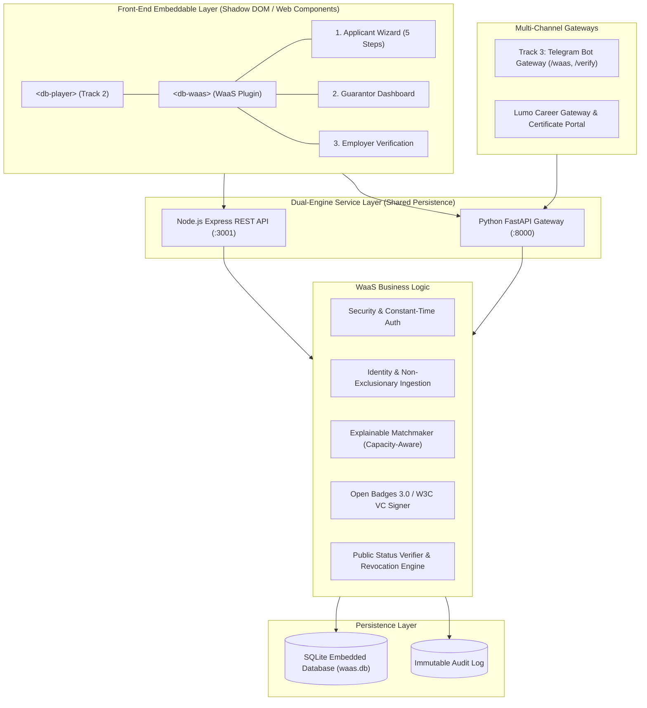
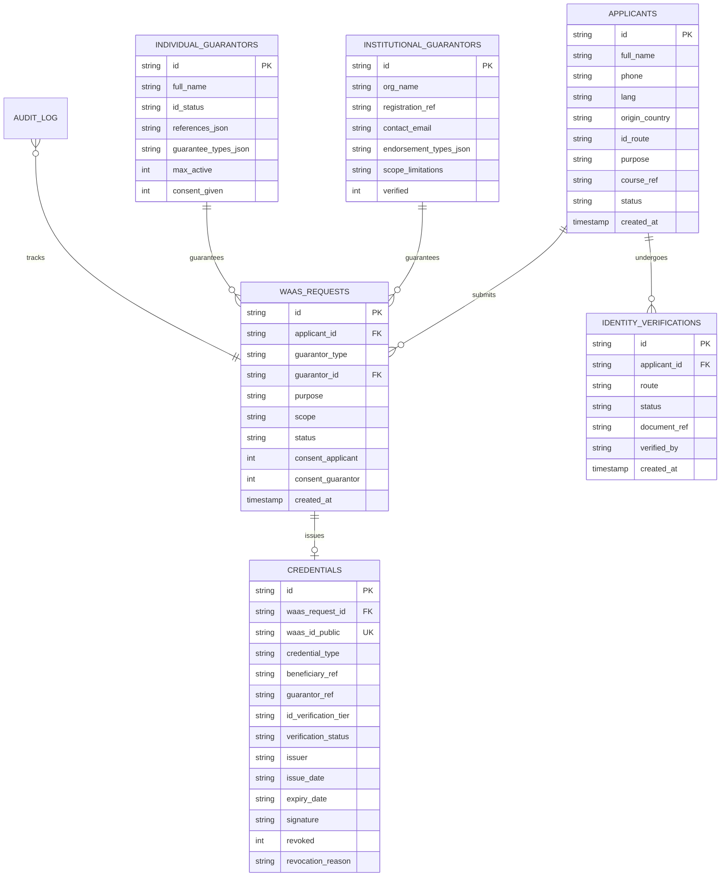

# Digital WaaS (ዋስ) — System Architecture

**Refugee Guarantor & Institutional Verification Infrastructure**  
*ALX Ethiopia Digital Bridge Hackathon 2026*

---

## 1. System Overview & Core Philosophy

**Digital WaaS (ዋስ - Ethiopian legal and customary institution of personal guarantee)** is an embeddable trust, consent, and verification infrastructure designed for displaced persons, refugees, and students who lack traditional collateral, formal banking histories, or national identity documents (Fayda / Kebele IDs).

### Core Ethical & Architectural Boundaries
1. **Zero Exclusion**: Human beings are **never excluded** because they lack a Kebele ID or Fayda ID. The system supports UNHCR refugee registration certificates, trusted partner referrals, and human-in-the-loop manual verification.
2. **No Numeric Human Scoring**: The system **never ranks or scores human beings** with arbitrary numbers (0–100) or describes individuals as "untrustworthy". Matchmaking is strictly categorical, rule-based, and explainable.
3. **Data Minimization & Zero Leaks**: Public verification endpoints verify validity and identity claims **without ever exposing** private phone numbers, national identification numbers, or raw identity documents.
4. **Decentralized & Interoperable**: Issued credentials adhere to the **W3C Verifiable Credentials Data Model v2.0** and **1EdTech Open Badges 3.0** standard with HMAC-SHA256 tamper-evident digital signatures.
5. **Universal Integration**: Integrates directly with Lumo Track 2 (`<db-player>` Web Component) and Track 3 (Accessible Telegram Gateway) without backend duplication.

---

## 2. System Architecture

---

## 3. Data Model & Database Schema

The system is backed by SQLite (`api/database/waas.db`) with foreign key constraints and indexed lookup fields:

---

## 4. End-to-End User Journeys

### Journey 1: Refugee / Displaced Learner Guarantee Request
1. Learner completes accessible training course on Lumo player (`<db-player>`).
2. Learner opens `<db-waas>` in `mode="applicant"`.
3. In Step 1 & 2, enters personal details and selects non-exclusionary ID route:
   - `refugee_id` (UNHCR / RRS registration card or camp manifest)
   - `partner_referral` (NGO, community mentor, or educator vouching)
   - `national_id` (Fayda / Kebele if available; automatic fallback to manual review if unavailable)
4. In Step 3, reviews and confirms explicit data-sharing consent.
5. In Step 4, selects matching institution (e.g., ALX Ethiopia Education Partner).
6. In Step 5, submits request and receives tracking reference (`req_...`).

### Journey 2: Institutional / Individual Review & Decision
1. Guarantor representative logs into `<db-waas mode="guarantor">`.
2. Inspects pending requests filtered by purpose (e.g. `education`, `employment`, `internship`).
3. Evaluates applicant's verified course completion without accessing private identity documents.
4. Executes explicit consent decision:
   - **Approve**: Updates request status to `approved`, sets `consent_guarantor = 1`.
   - **Decline**: Updates status to `declined` with clear, non-punitive rationale.

### Journey 3: Cryptographic Issuance & Open Badges 3.0 Packaging
1. WaaS backend issues an Open Badges 3.0 / W3C Verifiable Credential:
   - Assigns public reference identifier (`WAAS-MWIEKTMQ-70CF8C`).
   - Signs JSON-LD assertion with HMAC-SHA256 signature.
   - Generates high-contrast QR Code referencing verification URL.
   - Records credential in persistent ledger.

### Journey 4: Employer / Public Verification (Zero Leak)
1. Prospective employer or admissions office scans QR code or accesses `/api/v1/waas/verify/:waasId`.
2. System computes signature validity, checks expiration, and checks revocation index.
3. Returns human-readable, accessible verification card:
   - Status: `VALID`, `REVOKED`, `EXPIRED`, or `INVALID`.
   - Recipient Name: e.g. "Fatima Ahmed".
   - Verified Guarantor: e.g. "ALX Ethiopia Education Partner".
   - Purpose & Scope: "Educational & Professional Reference".
   - **Zero Privacy Leaks**: Phone numbers, camp locations, and national IDs remain sealed.

---

## 5. Track 2 and Track 3 Integration

| Integration Point | Implementation | Purpose |
| :--- | :--- | :--- |
| **Track 2 `<db-player>`** | `samples/waas-demo.html` | Embeds `<db-player>` alongside `<db-waas>` with zero CSS or DOM event collisions. |
| **Track 2 Career Gateway** | `samples/career-gateway.html` | Adds direct action button for job applicants to request institutional guarantor endorsement. |
| **Track 2 Certificate** | `samples/certificate.html` | Links Open Badges 3.0 certificates to the WaaS verification and guarantor network. |
| **Track 3 Telegram Bot** | `/waas` in `apps/telegram-bot/` | Displays accredited institutional guarantors to Telegram users with low-bandwidth access. |
| **Track 3 Telegram Bot** | `/verify <waas_id>` | Verifies authentic credentials directly inside Telegram chat without opening external browsers. |
