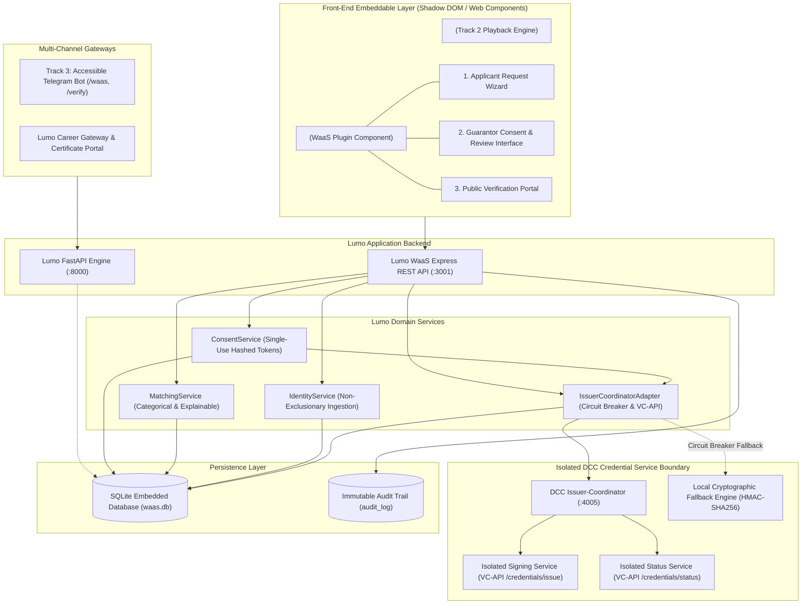
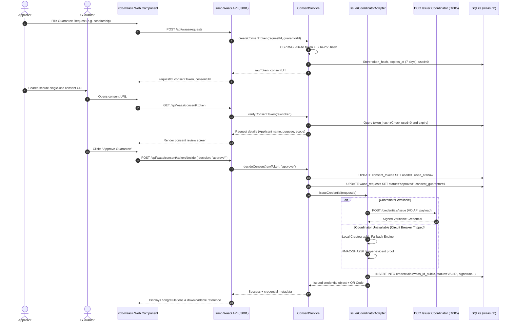
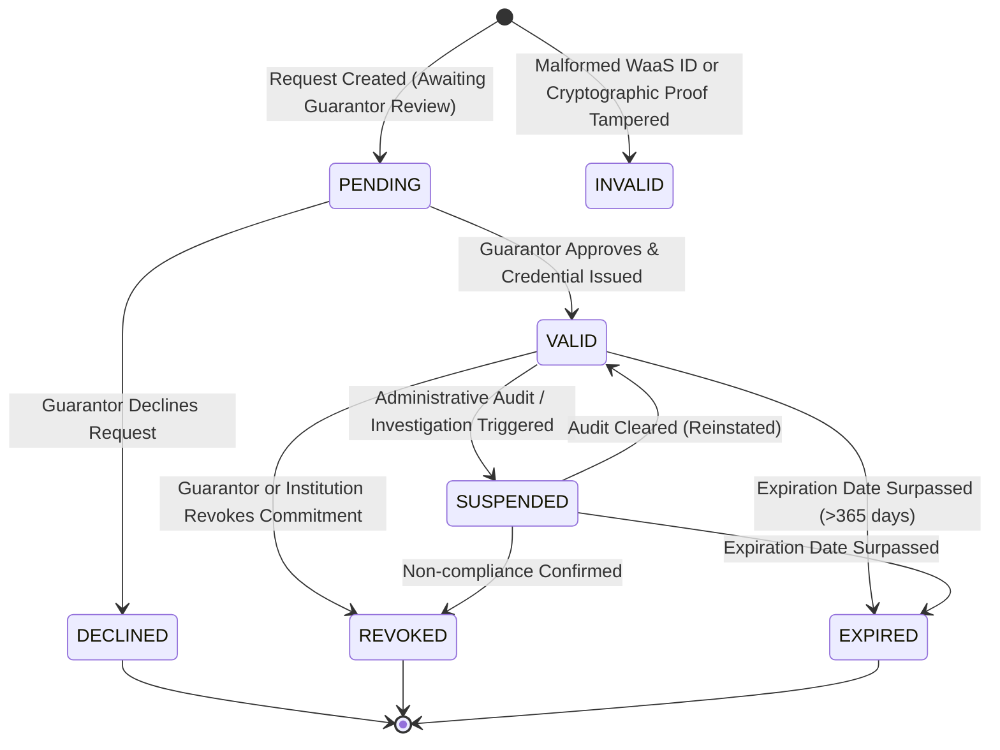

# Digital WaaS (ዋስ) — System Architecture

**Refugee Guarantor & Institutional Verification Infrastructure with DCC Issuer Coordinator Integration**  
*ALX Ethiopia Digital Bridge Hackathon 2026*

---

## 1. System Overview & Core Philosophy

**Digital WaaS (ዋስ - Ethiopian legal and customary institution of personal guarantee)** is an embeddable trust, consent, and verification infrastructure designed for displaced persons, refugees, and students who lack traditional collateral, formal banking histories, or national identity documents (Fayda / Kebele IDs).

### Core Ethical & Architectural Boundaries
1. **Zero Exclusion**: Human beings are **never excluded** because they lack a Kebele ID or Fayda ID. The system supports UNHCR refugee registration certificates, trusted partner referrals, and human-in-the-loop manual verification.
2. **No Numeric Human Scoring**: The system **never ranks or scores human beings** with arbitrary numbers (0–100) or describes individuals as "untrustworthy". Matchmaking is strictly categorical, rule-based, and explainable.
3. **Data Minimization & Zero Leaks**: Public verification endpoints verify validity and identity claims **without ever exposing** private phone numbers, national identification numbers, or raw identity documents.
4. **Decentralized & Interoperable**: Issued credentials adhere to the **W3C Verifiable Credentials Data Model v2.0** and **1EdTech Open Badges 3.0** standard with cryptographic digital signatures orchestrated via the Digital Credentials Consortium (DCC) VC-API architecture.
5. **Universal Integration**: Integrates directly with Lumo Track 2 (`<db-player>` Web Component) and Track 3 (Accessible Telegram Gateway) without backend duplication.

---

## 2. System Architecture Topology

The target architecture isolates the external credential issuance and status coordination components behind an adapter while keeping Lumo's existing SQLite backend and REST API as the authoritative system of record.



---

## 3. Single-Use Consent & Issuance Sequence

The consent lifecycle guarantees that credentials cannot be issued prematurely or without unforgeable guarantor consent.



---

## 4. Authoritative 6-Status Credential Lifecycle

Every credential query resolves to one of six authoritative statuses:



### Verification Status Definitions
| Status | Meaning | Public `isValid` | Actions Permitted |
| :--- | :--- | :---: | :--- |
| **`VALID`** | Active, verified reference signed by authorized guarantor. | `true` | Accepted by employers, universities, banks. |
| **`SUSPENDED`** | Temporarily frozen during document audit or procedural review. | `false` | Read-only; can be reinstated to `VALID` or escalated to `REVOKED`. |
| **`REVOKED`** | Terminated by guarantor or admin due to breach or job completion. | `false` | Permanent terminal state; displays audit reason. |
| **`EXPIRED`** | Credential exceeded validity period (default 1 year). | `false` | Archived; learner can request renewal. |
| **`PENDING`** | Request logged; consent not yet finalized by guarantor. | `false` | Awaiting guarantor action. |
| **`INVALID`** | Non-existent record or tampered cryptographic proof. | `false` | Immediate verification rejection. |

---

## 5. Multi-Tenant Architecture & Data Isolation

Lumo WaaS enforces strict tenant boundaries at the database and API gateway levels:

1. **Tenant Identification**: Inbound requests pass the `X-Tenant-ID` header (e.g. `alx_ethiopia`, `unhcr_partner`, `default`).
2. **Schema-Level Scoping**:
   - `waas_requests.tenant_id`: All guarantee requests are owned by an organization tenant.
   - `institutional_guarantors.tenant_id`: Accreditations are isolated per tenant.
   - `consent_tokens.tenant_id`: Tokens generated within Tenant A cannot be evaluated or listed within Tenant B.
   - `credentials.tenant_id`: Issued credentials carry the tenant context.
   - `organization_admins`: Role-based administrative assignments (`role IN ('admin','reviewer','auditor')`) restricted to authorized tenant records.
3. **Cross-Tenant Defense**: Any cross-tenant attempt to access request details yields an immediate `403 Forbidden` (`TENANT_MISMATCH`).

---

## 6. Resilient Circuit Breaker Pattern

To prevent external network partitions or downstream microservice restarts from halting educational and employment onboarding, the `IssuerCoordinatorAdapter` implements a stateful Circuit Breaker:

```
[Incoming Issuance Request]
            │
            ▼
    Is Circuit Breaker Open?
      ├── YES ──> Fallback to Local Cryptographic Engine (HMAC-SHA256)
      └── NO  ──> Attempt HTTP POST to DCC Issuer-Coordinator (:4005)
                     ├── 200 OK  ──> Reset Failures & Return Credential
                     └── Timeout / 5xx ──> Increment Failure Counter
                                             │
                                   Failures >= 3?
                                     ├── YES ──> Trip Breaker (OPEN for 30s)
                                     └── NO  ──> Local Cryptographic Engine Fallback
```

This guarantees 100% service uptime for displaced learners even during localized microservice outages.
