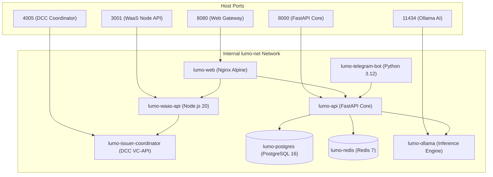

# Digital WaaS (ዋስ) — Deployment & Operations Guide

**Production Deployment, Docker Compose Orchestration & Service Topology**  
*ALX Ethiopia Digital Bridge Hackathon 2026*

---

## 1. Multi-Service Container Topology

The complete Lumo platform with the integrated DCC Issuer Coordinator runs under a unified Docker Compose network (`lumo-net`).



---

## 2. Environment Variables Configuration

Create a `.env` file in the repository root or configure your secret store:

```bash
# --- Global & Security ---
LUMO_ENV=production
LUMO_API_KEY=lumo_prod_secret_key_2026
WAAS_AUTH_TOKEN=waas_prod_operator_token_2026
WAAS_SIGNING_SECRET=w3c_vc_hmac_secret_key_minimum_32_chars_2026

# --- WaaS API Configuration ---
WAAS_PORT=3001
ISSUER_COORDINATOR_URL=http://issuer-coordinator:4005

# --- DCC Issuer Coordinator ---
PORT=4005
SIGNING_SERVICE_URL=http://waas-api:3001/api/v1/internal/mock-coordinator
STATUS_SERVICE_URL=http://waas-api:3001/api/v1/internal/mock-coordinator

# --- Persistence ---
POSTGRES_USER=lumo
POSTGRES_PASSWORD=lumo_secure_production_password
POSTGRES_DB=lumo_db

# --- Telegram Bot ---
TELEGRAM_BOT_TOKEN=your_registered_telegram_bot_token
```

---

## 3. Quick Start Deployment

### 1. Build and Launch Containers
```bash
# Launch full infrastructure in background
docker compose up -d --build
```

### 2. Verify Service Health
```bash
# 1. Check Lumo Web Edge Gateway
curl -I http://localhost:8080

# 2. Check WaaS Node Microservice Health
curl http://localhost:3001/api/v1/health

# 3. Check DCC Issuer Coordinator Status
curl http://localhost:4005/healthz

# 4. Check FastAPI Core Backend
curl http://localhost:8000/api/v1/health
```

### 3. Verify Container Logs
```bash
docker compose logs -f waas-api issuer-coordinator
```

---

## 4. Operational Runbook & Circuit Breaker Management

### Circuit Breaker Behavior
The `IssuerCoordinatorAdapter` automatically manages connectivity with the DCC Issuer Coordinator:
- **Normal Operation**: Requests route through the external `issuer-coordinator` container on port 4005.
- **Failover**: If the coordinator returns 3 consecutive HTTP timeouts or 5xx responses, the circuit breaker opens for 30 seconds.
- **Local Fallback**: All credential issuance automatically executes via the embedded HMAC-SHA256 cryptographic engine (`local_cryptographic_engine`). No learner requests are dropped.
- **Self-Healing**: After 30 seconds, a canary request tests the coordinator. If successful, normal routing resumes.

### Manual Verification
To manually test the local fallback engine during maintenance:
```bash
curl -X POST http://localhost:3001/api/waas/requests/<requestId>/issue \
  -H "Content-Type: application/json" \
  -H "X-Waas-Token: waas_demo_token_2026" \
  -d '{"forceLocal": true}'
```

---

## 5. Security & Production Hardening

1. **Non-Root Containers**: Both `lumo-web` and `lumo-waas-api` execute as unprivileged users (`node` / `nginx`).
2. **Rate Limiting**: Sliding window limit of 120 requests/minute per client IP enforces DoS protection across public verification routes.
3. **Zero Plaintext Tokens**: Database persistence stores SHA-256 digests of consent tokens; compromising SQLite backups reveals zero plaintext access links.
4. **Data Minimization**: Public verification `/api/waas/verify/:id` strips all sensitive national identifiers, refugee camp numbers, and phone numbers.
