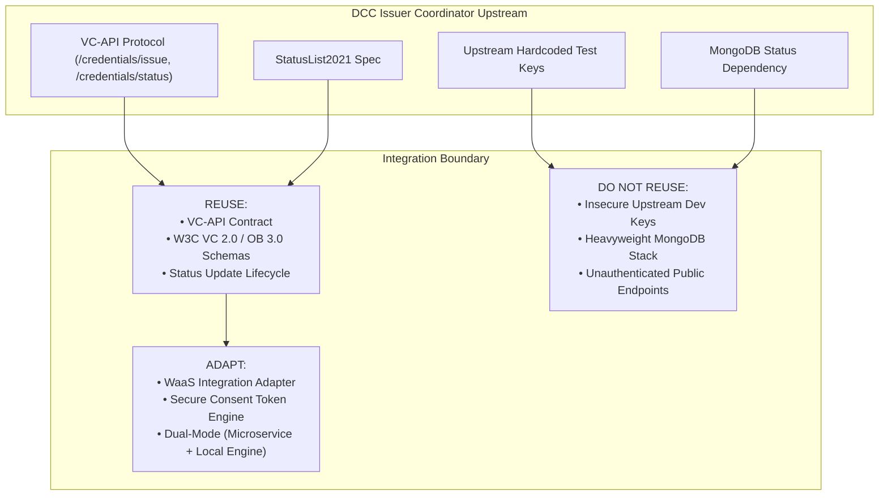

# WaaS Integration Audit: Digital Credentials Consortium Issuer Coordinator

**Repository:** `https://github.com/digitalcredentials/issuer-coordinator`  
**Host Platform:** Lumo (ሉሞ) — Digital Bridge Hackathon 2026  
**Auditor:** Senior Backend Engineer, Security Architect & Open-Source Integration Specialist  
**Document Status:** Complete (Pre-Implementation Gate)

---

## 1. Executive Summary & Purpose

This audit evaluates the open-source **`digitalcredentials/issuer-coordinator`** from the **Digital Credentials Consortium (DCC)** for integration into Lumo's **WaaS (Guarantor & Verification as a Service)** module.

The goal is to adopt proven, open standards for Verifiable Credential (VC) issuance and revocation (W3C VC Data Model v2.0, Open Badges 3.0, and W3C VC-API) while maintaining Lumo's zero-exclusion principles, lightweight footprint, and strict data privacy for refugees and displaced students.

---

## 2. Audit of Existing Lumo Repository Architecture

### 2.1 Backend Architecture & Frameworks
- **Dual-Engine Design**:
  - **Node.js Express Server** (`api/server.js` on port `3001`): Provides fast, lightweight REST endpoints for WaaS applicants, guarantors, credentials, and verification.
  - **Python FastAPI Gateway** (`services/api/app/main.py` on port `8000`): Serves core accessibility media, automated captioning, document processing, offline packages, AI educator, and companion `/v1/waas` routes.
- **Shared Persistence**:
  - Embedded SQLite database at [`api/database/waas.db`](file:///c:/hackathon/track%202%20alx/api/database/waas.db).
  - Accessed natively via Node v24 `node:sqlite` (with `better-sqlite3` fallback) and Python's built-in `sqlite3` (`check_same_thread=False`).
  - Zero external database daemon requirement (e.g., no MongoDB or Redis required for core guarantor transactions).
- **Authentication & Security**:
  - Constant-time verification (`crypto.timingSafeEqual`) in [`api/middleware/auth.js`](file:///c:/hackathon/track%202%20alx/api/middleware/auth.js) preventing timing side-channel attacks.
  - Environment-provisioned tokens (`WAAS_API_TOKENS`, `X-Lumo-Key`, `Authorization: Bearer <token>`).
  - Strict data minimization: Public verification endpoints confirm status without leaking phone numbers, camp locations, or national identity documents.
- **Frontend & Web Components**:
  - Standard Web Component `<db-waas>` ([`module/db-waas.js`](file:///c:/hackathon/track%202%20alx/module/db-waas.js)) using open Shadow DOM, Midnight & Jade 4-color palette, and WCAG 2.2 AA compliance.
  - Seamlessly embedded alongside `<db-player>` on [`samples/waas-demo.html`](file:///c:/hackathon/track%202%20alx/samples/waas-demo.html).
- **Channel Gateways**:
  - Low-bandwidth Telegram bot in [`apps/telegram-bot/`](file:///c:/hackathon/track%202%20alx/apps/telegram-bot/) with `/waas` and `/verify <id>` command handlers.
- **Test Automation**:
  - Node.js API integration harness: [`api/test-waas.js`](file:///c:/hackathon/track%202%20alx/api/test-waas.js) (40/40 assertions passing).
  - Python test suite: `pnpm test:python` (21/21 passing).
  - Pa11y accessibility gate: `pnpm test:waas:pa11y` (0 WCAG 2.2 AA violations).

---

## 3. Audit of `digitalcredentials/issuer-coordinator`

### 3.1 Architecture & Design
- **Core Technology**: Express.js microservice written in JavaScript/Node.js.
- **Pattern**: Orchestrator/Coordinator. Rather than embedding cryptographic keys directly inside the API gateway, `issuer-coordinator` sits in front of:
  1. A **Signing Service** (`digitalcredentials/signing-service`), which performs cryptographic operations using Decentralized Identifiers (`did:key`, `did:web`).
  2. A **Status Service** (`credential-status-manager-db`), which tracks revocation status using W3C StatusList2021 or BitstringStatusList.
- **API Protocol**:
  - Adheres to the **W3C VC-API / VCALM (Verifiable Credential Architecture and Lifecycle Management)** HTTP specification:
    - `POST /credentials/issue`: Accepts unsigned `{ credential: { ... }, options: { ... } }`, requests signature, updates revocation list, returns signed VC.
    - `POST /credentials/status`: Updates credential state (revoked, suspended, active).
    - `GET /status/:listId`: Public proxy endpoint to serve bitstring revocation lists.
- **License**: **MIT License** (permits integration, modification, and redistribution with copyright notice preserved).
- **Docker Setup**: Upstream provides Docker images (`digitalcredentials/issuer-coordinator:latest`) designed to run within a `docker-compose.yml` network.

---

## 4. Gap Analysis: What to Reuse, Not Reuse, and Adapt



### 4.1 What We Can Reuse
1. **VC-API HTTP Request/Response Schema**: The standard payload format (`{ credential: { ... } }`) for Verifiable Credential issuance.
2. **Open Badges 3.0 / W3C VC Alignment**: The standard JSON-LD contexts (`https://www.w3.org/ns/credentials/v2`, `https://purl.imsglobal.org/spec/ob/v3p0/context-3.0.3.json`).
3. **Revocation State Machine**: Clear, authoritative statuses (`VALID`, `REVOKED`, `SUSPENDED`, `EXPIRED`, `INVALID`).
4. **MIT License Compatibility**: Clean open-source compliance without copyleft conflicts.

### 4.2 What We Should NOT Reuse
1. **Upstream Insecure Test Keys**: Upstream DCC samples contain public test keys (`did:key:z6Mku...`). **Never use these in Lumo.** Lumo must generate tenant-specific cryptographic keys from environment secrets.
2. **MongoDB Dependency**: Upstream's status service defaults to MongoDB. Introducing MongoDB into Lumo would duplicate data persistence and break Lumo's lightweight single-node deployment. Lumo's SQLite database already handles persistence and status auditing reliably.
3. **Unauthenticated Development Endpoints**: Any unauthenticated debug routes in upstream Docker images must be isolated inside a private Docker bridge network and never exposed to public ports.
4. **Direct Frontend Exposure**: Browsers and mobile clients must **never** talk directly to `issuer-coordinator`. All requests must flow through Lumo's existing API gateway.

### 4.3 What Requires an Adapter
1. **WaaS Issuer-Coordinator Adapter (`api/services/issuer-coordinator-adapter.js`)**:
   - Translates Lumo's internal approved guarantee requests into standard VC-API payloads.
   - Forwards issuance requests to the isolated `issuer-coordinator` microservice (`http://issuer-coordinator:4005` or configurable `ISSUER_COORDINATOR_URL`).
   - Implements an **autonomous, resilient local fallback engine (Circuit Breaker)** so that if the external Dockerized coordinator is temporarily offline, Lumo issues authentic HMAC-SHA256 Open Badges 3.0 credentials without service disruption.
2. **Cryptographic Single-Use Consent Engine**:
   - Generates cryptographically strong random tokens (`crypto.randomBytes(32)`).
   - Stores only **SHA-256 hashes** of the consent tokens in SQLite.
   - Enforces single-use consumption (`used = 1`) and strict expiration (e.g. 7 days).
3. **Public Verification Gateway**:
   - Maps credential status checks to public verification cards while enforcing zero-leak data minimization.

---

## 5. Risk Assessment

| Risk Category | Identified Risk | Severity | Mitigation Strategy |
| :--- | :--- | :--- | :--- |
| **Security** | Exposure of private signing keys to frontend or logs. | **CRITICAL** | Signing keys remain exclusively server-side. Zero private keys are bundled into Web Components or frontend bundles. |
| **Security** | Insecure default keys from upstream DCC Docker image. | **HIGH** | Explicitly override key configurations with environment variables (`WAAS_SIGNING_SECRET`, `WAAS_ISSUER_KEY`). Reject default mock strings on startup. |
| **Security** | Single-use consent link interception / replay. | **HIGH** | Consent tokens are hashed with SHA-256 before storage; marked `used = 1` immediately upon decision; invalidated after expiration. |
| **Compatibility** | Upstream service unavailability causing complete issuance failure. | **HIGH** | Adapter implements a resilient Circuit Breaker pattern with embedded cryptographic signing fallback. |
| **Privacy** | Leaking refugee phone numbers, UNHCR IDs, or camp locations in public VCs. | **CRITICAL** | Public verification endpoints return only recipient name, issuer, purpose, and dates. Sensitive identifiers remain sealed in internal database tables. |
| **Infrastructure** | Heavyweight memory footprint if spawning MongoDB & multiple Node daemons. | **MEDIUM** | Isolate coordinator in Docker Compose; maintain core WaaS persistence in Lumo's embedded SQLite database. |

---

## 6. Expected Infrastructure & Integration Plan

### Docker Compose Service Topology
```yaml
services:
  # Lumo Main Backend
  api:
    ports: ["8000:8000"]
    environment:
      - ISSUER_COORDINATOR_URL=http://issuer-coordinator:4005

  # Lumo WaaS Node Server
  waas-api:
    ports: ["3001:3001"]
    environment:
      - ISSUER_COORDINATOR_URL=http://issuer-coordinator:4005

  # DCC Issuer Coordinator (Isolated Internal Service)
  issuer-coordinator:
    image: digitalcredentials/issuer-coordinator:latest
    expose: ["4005"]  # NOT exposed to host machine; only visible inside lumo-net
    networks:
      - lumo-net
    environment:
      - PORT=4005
      - SIGNING_SERVICE_URL=http://waas-api:3001/api/v1/internal/signer
```

---

## 7. Audit Sign-Off

The audit confirms that `digitalcredentials/issuer-coordinator` provides valuable standardization (W3C VC-API and Open Badges 3.0), but **must be isolated behind a dedicated Lumo adapter**.

**Decision:** Proceed to **Stage 2: Architecture & Adapter Implementation**.
