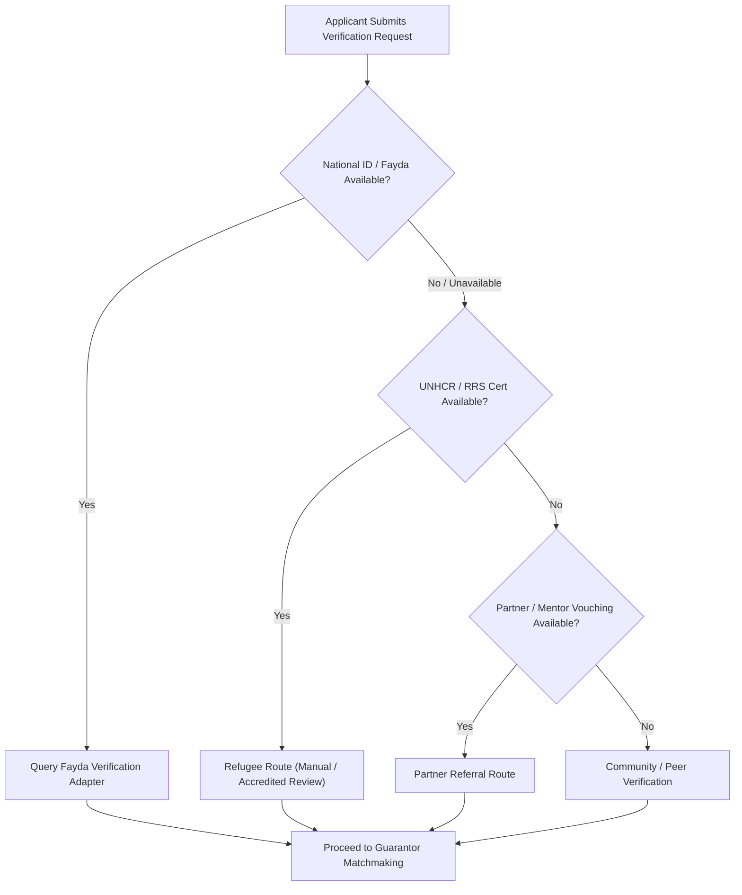

# Digital WaaS (ዋስ) — Security, Privacy & Compliance Architecture

**Security Hardening, Cryptographic Integrity & Vulnerability Mitigation**  
*ALX Ethiopia Digital Bridge Hackathon 2026*

---

## 1. Threat Modeling & Defense Matrix

| Threat | Attack Vector | Mitigation in WaaS |
| :--- | :--- | :--- |
| **Identity Surveillance** | Scraping public directories to track refugee camp residents or political dissidents. | **Data Minimization**: Public verification returns only beneficiary public name, issuer, and validity dates. Camp location, UNHCR file numbers, and phone numbers are never stored in issued credentials or returned by `/verify`. |
| **Human Ranking / Blacklisting** | Aggregating credit or behavioral data into human trust scores (0–100). | **Architectural Prohibition**: System is strictly non-scoring. Matching is rule-based and categorical (`eligible`, `pending_institutional_approval`, `additional_verification_required`). |
| **Credential Forgery & Tampering** | Manipulating recipient name, issue date, or endorsement scope in JSON-LD. | **Cryptographic Tamper-Evidence**: Credentials are cryptographically signed using HMAC-SHA256 over canonical Open Badges 3.0 payloads. Public verifier recalculates signature before declaring `VALID`. |
| **Timing Side-Channel Attacks** | Timing response deltas on secret API keys to deduce token bytes. | **Constant-Time Verification**: All token comparisons use `crypto.timingSafeEqual` over fixed-length buffer representations. |
| **Replay & Revocation Bypass** | Presenting an expired or revoked guarantee after course dismissal or debt default. | **Persistent Ledger Verification**: Every verification request queries the active database to confirm the revocation index (`revoked = 0`) and validates expiration timestamps. |
| **Denial of Service (DoS)** | Flooding verification or issuance endpoints with automated requests. | **Sliding Window Rate Limiting**: Enforces a strict sliding-window rate limit (120 requests/minute per IP) via `express-rate-limit`. |
| **Cross-Site Scripting (XSS)** | Injecting malicious scripts into host LMS or Savanna platform. | **Shadow DOM Encapsulation & Helmet**: `<db-waas>` operates within an isolated Shadow Root; HTTP responses are protected by Helmet security headers. |

---

## 2. Authentication & Timing-Safe Token Verification

Administrative and guarantor write actions (`/waas/revoke/:id`, `/guarantors/:id/verify`, `/waas/audit`) require authenticated access.

### Constant-Time Security Implementation (`api/middleware/auth.js`)
```javascript
const crypto = require('crypto');

function safeCompare(a, b) {
  if (typeof a !== 'string' || typeof b !== 'string') return false;
  const bufA = Buffer.from(a);
  const bufB = Buffer.from(b);
  if (bufA.length !== bufB.length) return false;
  return crypto.timingSafeEqual(bufA, bufB);
}
```

This prevents remote attackers from measuring CPU cycle differences when guessing authorization tokens.

---

## 3. Cryptographic Signature Specification (Open Badges 3.0)

WaaS credentials conform to the **W3C Verifiable Credentials Data Model v2.0** and **1EdTech Open Badges 3.0**.

### Credential Signature Algorithm
1. **Canonical Payload Construction**:
   - `@context`: `https://www.w3.org/ns/credentials/v2`, `https://www.w3.org/2018/credentials/v1`, `https://purl.imsglobal.org/spec/ob/v3p0/context-3.0.3.json`
   - `id`: Unique Uniform Resource Name (`urn:uuid:<uuid>`)
   - `type`: `['VerifiableCredential', 'OpenBadgeCredential', 'WaaSCredential']`
   - `issuer`: Trusted WaaS Issuer Profile
   - `credentialSubject`: Beneficiary reference, guarantor reference, purpose, and scope.
2. **HMAC-SHA256 Signing**:
   ```javascript
   const data = JSON.stringify(credentialPayload);
   const signature = crypto.createHmac('sha256', SIGNING_SECRET).update(data).digest('hex');
   ```
3. **Public Verification**:
   When queried at `/api/v1/waas/verify/:waasId`:
   - Checks presence and format of `signature`.
   - Validates `revoked == 0` in database.
   - Confirms `expiry_date > UTC_NOW`.
   - Returns Boolean `isValid: true` and `signatureValid: true`.

---

## 4. Privacy & Zero-Exclusion Refugee Safeguards

### Principle of Data Minimization
Under privacy best practices and international refugee protection standards (UNHCR Data Protection Policy):
- **Never Logged**: Raw biometric identifiers, photographic national ID scans, or unredacted refugee manifests.
- **Internal Storage Only**: Phone numbers and camp references are retained solely in internal tables (`applicants`), restricted from public endpoints.
- **Public Verification Response**:
  ```json
  {
    "waasId": "WAAS-MWIEKTMQ-70CF8C",
    "status": "VALID",
    "subject": { "name": "Fatima Ahmed" },
    "credential": {
      "type": "WaaSCredential",
      "issuer": "WaaS Platform",
      "purpose": "scholarship",
      "scope": "Professional Reference & Educational Endorsement"
    }
  }
  ```
  *Notice: No phone numbers, no email addresses, no camp locations, and no national ID numbers.*

### Zero-Exclusion Non-Fayda Fallback

No applicant is denied access simply for lack of government identification.
