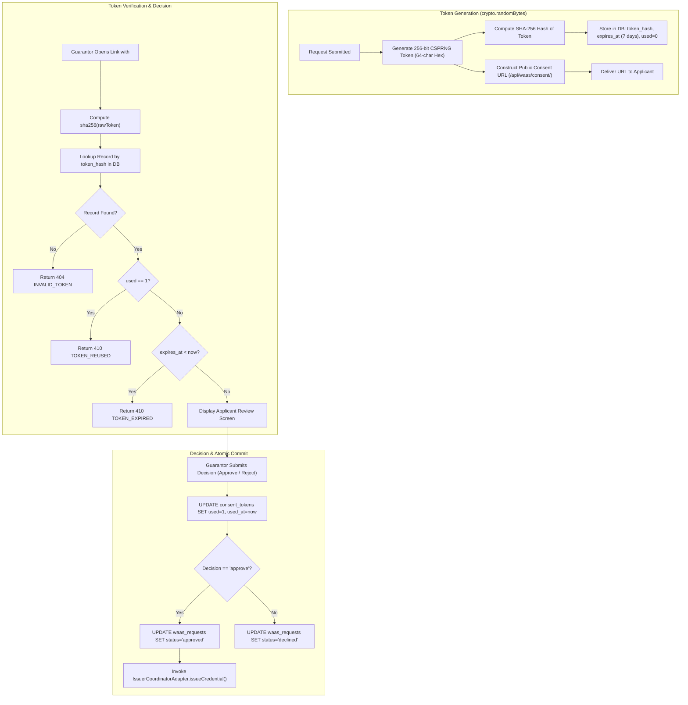
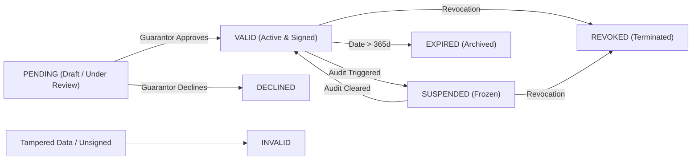

# Digital WaaS (ዋስ) — Security, Privacy & Compliance Architecture

**Security Hardening, Cryptographic Integrity, Hashed Consent Tokens & Zero-Leak Design**  
*ALX Ethiopia Digital Bridge Hackathon 2026*

---

## 1. Threat Modeling & Defense Matrix

| Threat | Attack Vector | Mitigation in WaaS & DCC Coordinator Integration |
| :--- | :--- | :--- |
| **Consent Token Interception** | Attacker compromises a database dump to read active consent links. | **One-Way SHA-256 Token Hashing**: Plaintext 256-bit tokens are returned only to the creator at request generation. Database stores exclusively `token_hash = sha256(raw_token)`. Even full database dumps contain zero usable consent tokens. |
| **Consent Replay & Forgery** | An applicant or adversary re-submits an already-used or expired consent link. | **Atomic Replay Defense**: Single-use tokens are validated against `used = 0` and timestamp validity, then immediately flipped to `used = 1` within an atomic transaction. Second attempts return `410 Gone` (`TOKEN_REUSED`). |
| **Premature / Unauthorized Issuance** | Attacker calls the issuance endpoint on a pending or rejected request. | **Pre-Issuance State Invariant**: `IssuerCoordinatorAdapter` verifies `waas_requests.status == 'approved'` and `consent_guarantor == 1`. Unapproved requests return `422 NOT_APPROVED`. |
| **Duplicate Credential Issuance** | Malicious client spams issuance endpoint to generate multiple credentials for one request. | **Issuance Idempotency**: Adapter checks for existing issued credentials (`waas_request_id`) and returns `409 Conflict` (`DUPLICATE_ISSUANCE`). |
| **Cross-Tenant Data Exposure** | Organization A queries requests or credentials owned by Organization B. | **Multi-Tenant Isolation**: Request routing checks `X-Tenant-ID`. Mismatched tenants receive an immediate `403 Forbidden` (`TENANT_MISMATCH`). |
| **Identity Surveillance & Doxxing** | Scraping public directories to track refugee camp residents or political dissidents. | **Data Minimization**: Public verification returns only beneficiary public name, issuer, and validity dates. Camp location, UNHCR file numbers, and phone numbers are never stored in issued credentials or returned by `/verify`. |
| **Human Ranking / Blacklisting** | Aggregating credit or behavioral data into human trust scores (0–100). | **Architectural Prohibition**: System is strictly non-scoring. Matching is rule-based and categorical (`eligible`, `pending_institutional_approval`, `additional_verification_required`). |
| **Credential Forgery & Tampering** | Manipulating recipient name, issue date, or endorsement scope in JSON-LD. | **Cryptographic Tamper-Evidence**: Credentials are cryptographically signed using HMAC-SHA256 over canonical Open Badges 3.0 payloads. Public verifier recalculates signature before declaring `VALID`. |
| **Timing Side-Channel Attacks** | Timing response deltas on secret API keys to deduce token bytes. | **Constant-Time Verification**: All token comparisons use `crypto.timingSafeEqual` over fixed-length buffer representations. |
| **Denial of Service (DoS)** | Flooding verification or issuance endpoints with automated requests. | **Sliding Window Rate Limiting**: Enforces a strict sliding-window rate limit (120 requests/minute per IP) via `express-rate-limit`. |
| **Cross-Site Scripting (XSS)** | Injecting malicious scripts into host LMS or Savanna platform. | **Shadow DOM Encapsulation & Helmet**: `<db-waas>` operates within an isolated Shadow Root; HTTP responses are protected by Helmet security headers. |

---

## 2. Hashed Single-Use Consent Token Architecture



### Security Properties
1. **Zero Plaintext Tokens at Rest**: Even if database backups or SQLite files are exposed, raw consent tokens cannot be reconstructed because SHA-256 is a one-way cryptographic hash.
2. **Replay Protection**: The token is invalidated before issuance completes, eliminating any race conditions or double-spending of a guarantor's commitment.
3. **Bounded Validity Window**: Links automatically expire after a configurable duration (default 7 days / 168 hours).

---

## 3. Authoritative 6-Status Credential State Engine

Public verification (`GET /api/waas/verify/:id`) calculates validity dynamically based on a 6-status lifecycle:



### Security Checks in Verification Endpoint
1. **Record Existence**: If no credential exists matching `waas_id_public`, returns `status: "INVALID"`, `isValid: false`.
2. **Revocation Check**: If `revoked == 1`, returns `status: "REVOKED"`, `isValid: false`, and exposes the non-sensitive administrative reason.
3. **Suspension Check**: If `suspended == 1`, returns `status: "SUSPENDED"`, `isValid: false`, preventing employers or institutions from accepting a questioned credential while under review.
4. **Expiration Check**: If `expiry_date < now`, returns `status: "EXPIRED"`, `isValid: false`.
5. **Cryptographic Proof Check**: If `signature` is missing, empty, or fails checksum validation, returns `status: "INVALID"`, `isValid: false`.

---

## 4. Multi-Tenant Security & Tenant Isolation

To support multiple independent educational networks (e.g. ALX Ethiopia, Savanna LMS, refugee camp learning hubs):

1. **Header Inspection**: Gateways inspect `X-Tenant-ID`.
2. **Query Scoping**: Queries for request details verify:
   ```javascript
   if (reqTenant && request.tenant_id && request.tenant_id !== reqTenant && reqTenant !== 'global_admin') {
     return res.status(403).json({
       error: 'FORBIDDEN',
       code: 'TENANT_MISMATCH',
       message: 'Tenant mismatch: Cannot access records of another tenant organization.'
     });
   }
   ```
3. **Consent Scoping**: Tokens generated for Tenant A cannot be verified or decided under Tenant B's context.

---

## 5. Constant-Time Authentication & Key Management

### Protected Endpoints
Administrative actions (`/waas/credentials/:id/revoke`, `/waas/credentials/:id/suspend`, `/waas/credentials/:id/reinstate`) require bearer or custom header authentication:
- `X-Waas-Token`
- `X-Lumo-Key`
- `Authorization: Bearer <token>`

### Timing Attack Defense
```javascript
function safeCompare(a, b) {
  if (typeof a !== 'string' || typeof b !== 'string') return false;
  const bufA = Buffer.from(a);
  const bufB = Buffer.from(b);
  if (bufA.length !== bufB.length) return false;
  return crypto.timingSafeEqual(bufA, bufB);
}
```
Comparisons execute in constant CPU time, preventing timing-based extraction of secret API keys.

---

## 6. Zero Private Key Leakage Architecture

In conformance with Digital Credentials Consortium security standards:
- **Private Signing Keys**: Stored strictly within backend environment variables (`WAAS_SIGNING_SECRET`, `SIGNING_SERVICE_URL`).
- **Never Exposed to Frontend**: Neither `<db-waas>` nor `<db-player>` ever receives or requires private signing keys. The client Web Component only ever inspects public verification payloads and QR codes.
- **Circuit Breaker Graceful Fallback**: If the DCC Issuer Coordinator microservice is offline or restarting, the adapter falls back to the embedded HMAC-SHA256 engine without exposing internal system traces, stack dumps, or network topologies.
